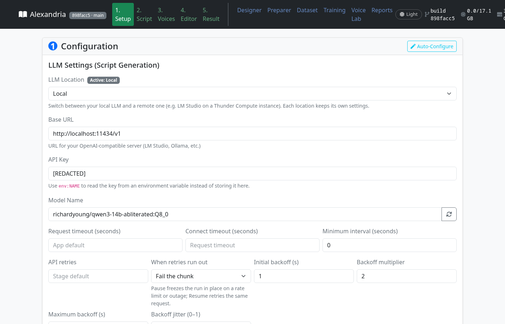
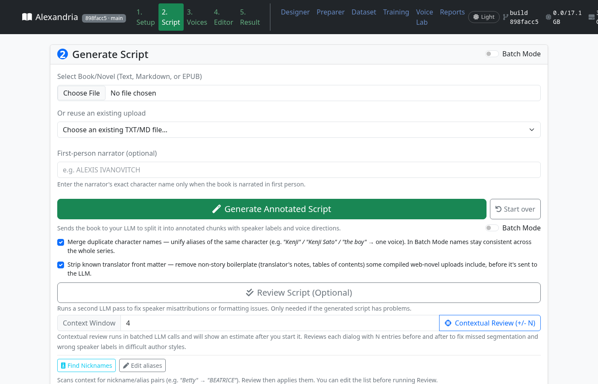
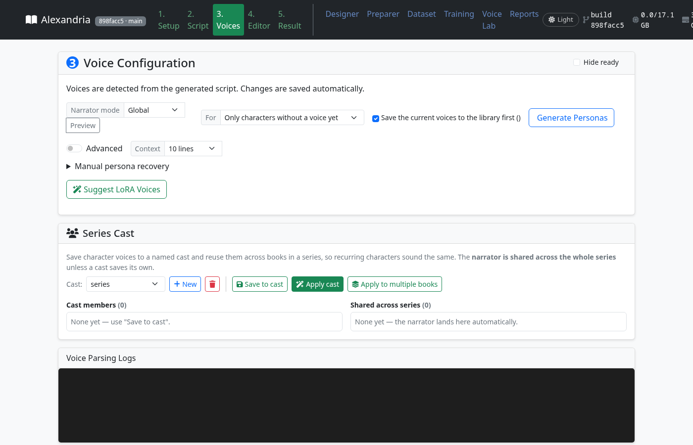
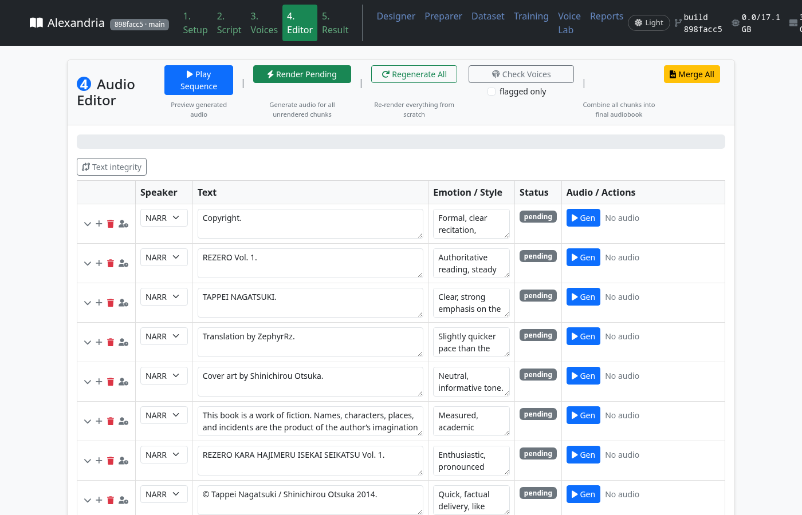
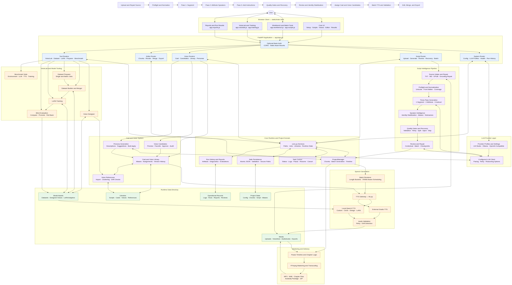

<p align="center">
  
</p>

# Alexandria Audiobook2

[English](README.md) | [中文](README_CN.md) | [日本語](README_JA.md) | Español · [Escucha una muestra](https://github.com/user-attachments/files/25276110/sample.mp3)

Alexandria Audiobook2 convierte un libro en un audiolibro con una voz distinta para
cada personaje. Le das un archivo `.txt`, `.md` o `.epub`; un modelo de lenguaje
determina quién dice cada línea y cómo debería sonar; un modelo de texto a voz
la lee; y obtienes un MP3 o un M4B con capítulos.

## Dónde empezar

| Quiero… | Empieza aquí |
|---|---|
| **Hacer un audiolibro** | [Instala](#instalación) y luego sigue [tu primer audiolibro](#tu-primer-audiolibro). |
| **Elegir un modelo para mi tarjeta gráfica** | [Qué modelo para tu tarjeta](#qué-modelo-para-tu-tarjeta) y luego la [guía completa](docs/wiki/Which-Model-For-Your-Card-ES.md). |
| **Entender los resultados de la investigación** | [Resultados de un vistazo](#resultados-de-un-vistazo) y luego [RECIPES.md](RECIPES.md) y la [comparación de quants de Muse](docs/results/muse-quant-baselines.md). |
| **Encontrar una ejecución concreta o sus datos en bruto** | Busca en el [índice de resultados](RESULTS_INDEX.md); cada entrada enlaza al artefacto versionado. |
| **Explorar toda la documentación** | El [mapa de documentación](docs/README.md) lista guías de usuario, notas de operaciones, resultados e historial. |
| **Colaborar** | La [wiki del proyecto](https://github.com/on22s/alexandria-audiobook2/wiki) y luego [Colaborar](#colaborar) y [GOALS.md](GOALS.md). |

No necesitas leer ninguna de las secciones de investigación para instalar o usar la app.

## Investigación y desarrollo

Es un fork de investigación de [Alexandria](https://github.com/Finrandojin/alexandria-audiobook).
Lo que lo hace distinto es que **cada decisión se mide**:

- qué modelo y qué prompt eligen al hablante correcto, puntuados contra libros en los que
  se ha etiquetado cada línea;
- cuánto se acerca una voz generada a una lectura humana real;
- si detalles como el acento tonal del japonés sobreviven a la síntesis.

Los ajustes que ganaron son los valores por defecto, y toda alternativa sigue siendo seleccionable
en la pestaña Setup. Por ejemplo, el prompt de atribución `michel2_full` se convirtió en el
valor por defecto el 2026-09-19, una vez que la última familia de modelos confirmó que era el mejor. Los
números, los fallos y las recetas están todos en este repositorio.

**Documentos clave**

- **[GOALS.md](GOALS.md)** — qué significa "bueno" para cada objetivo, con la medición actual
- **[RECIPES.md](RECIPES.md)** — los ajustes de entrenamiento y servido que funcionaron, cada uno con el ajuste parecido que falló
- **[RESULTS_INDEX.md](RESULTS_INDEX.md)** — todos los artefactos de experimentos
- **[Adaptadores en Hugging Face](https://huggingface.co/Om22s/alexandria-qwen3-attribution)**, y **[HF_MODEL_GUIDE.md](HF_MODEL_GUIDE.md)** para cómo se publican

---

## Requisitos

- **[Pinokio](https://pinokio.computer/)**, o Docker / Google Colab (ver [Instalación](#instalación)).
- **Un servidor de modelo de lenguaje (LLM)** al que la app pueda llegar mediante una API compatible con OpenAI.
  La app no incluye uno. Cualquiera de estos sirve:
  - [llama.cpp](https://github.com/ggml-org/llama.cpp) `llama-server`: todos los números de
    este README se midieron con él. Admiten `--lora` para los adaptadores de atribución
    y `--reasoning-budget` para modelos de razonamiento.
  - [LM Studio](https://lmstudio.ai/) u [Ollama](https://ollama.ai/).
  - Una API alojada. Se midió DeepSeek v4-pro; cualquier endpoint de estilo OpenAI funciona.

  [Modelos de LLM recomendados](#modelos-de-llm-recomendados) lista lo que aporta cada tamaño de modelo.
- **Una GPU para la generación de voz**: 8 GB de VRAM como mínimo, 16 GB recomendados.
  - Cada modelo TTS ocupa unos 3.4 GB; el resto de la memoria decide el tamaño de lote.
  - El LLM necesita su propia memoria. Una tarjeta de 16 GB puede alojar un modelo de lenguaje de 9-13 GB
    *o* renderizar audio. El bloqueo de GPU de la app impide que los dos choquen, salvo que
    le digas que el LLM se ejecuta en otro sitio.
- **RAM**: 16 GB recomendados.
- **Disco**: unos 20 GB para el entorno y los pesos TTS, más tus archivos de LLM y audio.

### Compatibilidad de GPU

| GPU | SO | Voz (TTS) | Notas |
|-----|----|--------------|-------|
| **NVIDIA** | Windows / Linux | completa | compilación CUDA mediante `torch.js` con flash attention; whisper.cpp compilado con CUDA para el Preparer |
| **AMD dedicada** | Linux | completa | ROCm; probada a diario en una RX 9070 XT (RDNA4, ROCm 7.0). llama-cpp-python y whisper.cpp se compilan con HIP para tu objetivo `gfx` durante la instalación |
| **APU AMD / integrada** | Linux | completa, más lenta | el TTS corre en fp32 (bf16 está roto en la clase 660M/680M/780M); todo lo demás es igual |
| **AMD** | Windows | solo CPU | ROCm no está disponible en Windows; usa Linux para GPU |
| **Apple Silicon** | macOS | solo CPU | El dispositivo TTS `auto` usa CPU. MPS se puede seleccionar explícitamente, pero en un M4 fue más lento y menos preciso (#1650); whisper.cpp se compila con Metal |
| **Intel** | macOS | solo CPU | |

> **Más documentación:** la [wiki](https://github.com/Finrandojin/alexandria-audiobook/wiki) del proyecto upstream
> sigue explicando bien los tipos de voz, el entrenamiento LoRA y la generación por lotes. Donde este fork
> se comporta de forma distinta, este README y `RECIPES.md` son los correctos.

## Instalación

### Opción A: Pinokio (recomendada)

1. Instala [Pinokio](https://pinokio.computer/).
2. En Pinokio, haz clic en **Download** y pega `https://github.com/on22s/alexandria-audiobook2`.
3. Haz clic en **Install**. Esto:
   - crea `app/env`;
   - instala la versión correcta de torch para tu máquina (`torch.js`) y la fija,
     para que ningún paso posterior pueda cambiarla por una compilación solo de CPU;
   - compila llama-cpp-python y whisper.cpp para tu GPU.
4. Haz clic en **Start** y luego en **Open Web UI**.

Las instalaciones nuevas de Pinokio usan CPython 3.10 para los wheels precompilados de NVIDIA SageAttention/FlashAttention. Los entornos existentes se conservan; pedir esos wheels opcionales desde otra versión de Python se detiene antes de instalar paquetes con un error de compatibilidad.

### Opción B: Google Colab (sin instalación)

[](https://colab.research.google.com/github/on22s/alexandria-audiobook2/blob/main/alexandria_colab.ipynb)

Ejecuta la app en una GPU T4 gratuita. Necesitas una cuenta gratuita de [ngrok](https://dashboard.ngrok.com/signup)
para el túnel; el notebook te guía paso a paso.

Consulta la [guía de Colab](docs/guides/COLAB_ES.md) para errores de instalación y logs,
almacenamiento temporal y el traspaso de GPU de Ollama al TTS.

### Opción C: Docker (NVIDIA)

```bash
git clone https://github.com/on22s/alexandria-audiobook2.git
cd alexandria-audiobook2
docker compose up --build
```

- Necesita [Docker](https://docs.docker.com/get-docker/) con el
  [NVIDIA Container Toolkit](https://docs.nvidia.com/datacenter/cloud-native/container-toolkit/install-guide.html).
- La interfaz está en `http://localhost:4200`.
- Los pesos TTS se descargan en un volumen la primera vez que renderizas.
- Las subidas, los ajustes de voz, los adaptadores y el audio se guardan en disco mediante un bind mount.

> **Seguridad:** Compose publica el puerto solo en `127.0.0.1`. El contenedor en sí
> enlaza `0.0.0.0`, porque Docker lo necesita para el reenvío. Si publicas el puerto del host
> en `0.0.0.0`, define también `ALEXANDRIA_AUTH_PASSWORD`; ver
> [Autenticación](#autenticación-opcional).

## Primer arranque: qué esperar

### 1. Inicia primero un servidor de LLM

Alexandria no incluye un modelo de lenguaje. Antes de generar un guion, uno de estos
debe estar en ejecución y accesible desde la **Base URL** de la pestaña Setup.

- **llama.cpp** (recomendado; los números de aquí se midieron con él):

  ```bash
  llama-server -m Qwen3-14B-Q4_K_M.gguf --host 127.0.0.1 --port 8090 \
    -ngl 99 -c 8192 --parallel 1 --flash-attn on \
    --reasoning on --reasoning-format deepseek --reasoning-budget 1024
  ```

  En Setup, usa la Base URL `http://127.0.0.1:8090/v1`, la clave de API `local` y, como nombre de modelo,
  lo que diga `--alias` (o el nombre del archivo).

- **LM Studio**: carga un modelo, inicia su servidor y usa `http://localhost:1234/v1`.
  **Optimize LM Studio settings** aplica los ajustes de carga protegidos y específicos del modelo de la app;
  su respaldo local es de 8,192 tokens y una ranura, no un ajuste universal de 32k.

- **Ollama**: usa `http://localhost:11434/v1` y el nombre de modelo que muestre `ollama list`.

- **Una API alojada**: pon **LLM Location** en *Remote*, pega la URL y la clave (o
  `env:DEEPSEEK_API_KEY` para leer la clave de una variable de entorno) y abre
  **Provider request options**. Pon **Runs on this machine's GPU?** en **No** para que el audio se renderice mientras trabaja el modelo alojado.

El comando es una configuración inicial para una primera ejecución pequeña, no una garantía de que cada
solicitud quepa. Usa la ruta real de tu modelo descargado. El contexto debe contener el prompt completo
(incluidos el reparto y el texto circundante) más la respuesta y cualquier token de razonamiento. Los lotes
más grandes, las ventanas de revisión o los prompts personalizados pueden necesitar más; ver
[elegir un tamaño de contexto](docs/wiki/Setup-and-Serving-ES.md#elegir-un-tamaño-de-contexto).
Los adaptadores de atribución son opcionales y deben coincidir con su prompt de entrenamiento; déjalos fuera de
la primera ejecución y luego sigue [Adaptadores](#adaptadores).

**Los modelos de razonamiento ("thinking") funcionan bien; de hecho, mejor.** Pon **Reasoning effort**
en *low* y deja que el servidor limite el presupuesto. No añadas `<think>` a los tokens prohibidos.
Haz clic en **Test** en Setup para confirmar la conexión y ver qué responde el modelo.

### 2. La primera generación de voz descarga unos 3.5 GB

Los pesos de Qwen3-TTS (unos 3.4 GB por variante: CustomVoice, y Base para
voces de clonación/diseño/LoRA) se descargan la primera vez que renderizas. Vigila el log del Editor. Una
descarga atascada en 0% es un problema de red, no una app congelada.

### 3. El primer lote es más lento

El modelo tiene que cargarse y, si **Compile Codec** está activado, `torch.compile` tarda otros
30-60 segundos. La línea de actividad del Editor te dice cuál de las dos cosas está pasando.

### 4. La memoria de GPU decide qué puede ejecutarse a la vez

La voz necesita unos 3.4 GB más espacio para los lotes, y un LLM en la misma tarjeta necesita su
propio espacio. Por eso el bloqueo de GPU se niega a iniciar audio mientras la generación de guion está usando
la tarjeta, *salvo* que el perfil LLM activo esté marcado como no presente en esta GPU (una API alojada o
una segunda máquina). Entonces la anotación y el renderizado pueden ejecutarse juntos.

### 5. Dónde mirar cuando algo va mal

- La **línea de actividad** bajo el botón Generate de la pestaña Script: qué espera la ejecución,
  en qué intento va y cuánto tiempo queda.
- `logs/api/<task>-latest.log`: el log completo de cada tarea en segundo plano.
- `logs/llm_responses.log` y `logs/review_responses.log`: cada respuesta del LLM durante la generación
  y revisión de guiones, con el motivo de finalización, los recuentos de tokens y el tiempo empleado. El
  `*.requests.log` junto a cada uno guarda la solicitud exacta detrás de cada respuesta (emparejada por su
  id `request=`), así que una respuesta mala se puede reproducir.
- `GET /api/status/eta` y `GET /api/status/<task>` para cualquier cosa que esté en ejecución.
- La pestaña **Reports**: historial de ejecuciones con artefactos y puntos de control de revisión.

## Tu primer audiolibro

Sigue **Setup → Script → Voices → Editor → Result**. Las capturas muestran la interfaz
existente; las etiquetas pueden variar según la compilación. El primer éxito significa descargar un MP3 y escuchar
en busca de líneas faltantes y hablantes incorrectos.

### Antes de empezar

- Empieza con unos párrafos como `.txt`, `.md` o `.epub`, en lugar de un libro entero.
  Guarda [esta muestra original de dos personajes](docs/examples/first-book.txt) como archivo `.txt`
  para probar el flujo completo sin buscar antes un libro.
- Un servidor LLM en ejecución (ver [la sección anterior](#1-inicia-primero-un-servidor-de-llm)).
  Un modelo Qwen3-14B de 9 GB en una tarjeta de 16 GB basta para un buen guion;
  [Modelos de LLM recomendados](#modelos-de-llm-recomendados) dice lo que aporta cada tamaño.
- Tiempo para la primera descarga de modelo y el calentamiento. El tiempo de ejecución depende de la longitud del texto, el modelo,
  el hardware y los ajustes; la pestaña Script estima el tiempo restante una vez que ha avanzado.

### Paso 1 — Setup

La barra lateral de Setup tiene un selector **Setup UI language (partial coverage)** encima
del buscador de ajustes. El texto del buscador, incluida su retroalimentación de búsqueda, la acción **Preview changes**,
el título de la vista previa, la acción **Close preview**, el resumen de valores por defecto y los encabezados de columna
**Saved**/**Would save** usan el catálogo de mensajes en inglés. Los recuentos
se conservan. El modo opcional **Pseudo-English** expande esos mensajes para probar el diseño; no es
una traducción revisada. Los nombres de ajuste, los valores de comparación, los marcadores de valor por defecto,
la ayuda contextual y las advertencias de seguridad siguen en inglés. La preferencia es local del navegador, se sincroniza entre pestañas
del mismo origen cuando hay almacenamiento disponible, y nunca cambia el idioma del libro, del TTS ni de la transcripción,
los valores de configuración ni los identificadores técnicos enviados. Las configuraciones regionales no admitidas
(incluidos los códigos de idioma RTL) recurren al inglés sin cambiar la dirección del diseño.
El marcado sin catalogar conserva su texto en inglés o su marcador de posición en lugar de mostrar una clave de mensaje.
No se promete ninguna configuración regional RTL ni una traducción completa de la interfaz. La base acotada del catálogo
pedida en el #1732 está completa; las traducciones revisadas y los flujos adicionales son trabajo futuro.
Consulta [el registro de aceptación](docs/setup-ui-catalog.md) para el alcance, las pruebas y los límites exactos.

Para la solución de problemas, **Setup > Speech engine > Refresh report** muestra el JSON exacto
del informe de soporte local antes de la descarga. Nada se sube automáticamente. Consulta
[el contenido del informe de soporte y los límites de privacidad](docs/support-report.md) antes de compartirlo.



1. Elige **LLM Location** (Local o Remote).
2. Rellena **Base URL**, **API Key** y **Model Name**. El botón de refrescar lista los
   modelos que ofrece el servidor.
3. Para un modelo de razonamiento, pon **Reasoning effort** en *low*.
4. Haz clic en **Test Connection**.
5. Deja la sección TTS en `local` / `auto`. **Auto-Configure** rellena los ajustes de lote del TTS
   para tu tarjeta.
6. En **Prompt Settings**, el prompt de atribución ya es `michel2_full`, el valor por defecto medido
   del proyecto; las excepciones específicas por modelo están en los resultados de abajo.
7. Haz clic en **Save Configuration**.

### Paso 2 — Script



1. Elige el libro, o reutiliza uno que hayas subido antes.
2. Si la novela está narrada en primera persona, escribe el nombre exacto de ese personaje.
3. Haz clic en **Test this book with the LLM** para muestrear primero el libro. Que pase no garantiza
   que todos los fragmentos posteriores funcionen. Luego haz clic en **Generate Annotated Script**. La línea de actividad muestra los tres pasos mientras
   se ejecutan: *Step 1 (split) · unit 3 of 41 — asking the model*, luego *Step 2 (speakers)*,
   y luego *Step 3 (delivery)*, con los reintentos y, una vez que conoce su velocidad, el tiempo restante.
   - Puedes **Pause**, **Save snapshot** (conservar la parte terminada como guion),
     **Start over**, o más tarde **Resume failed run**.
4. Cuando termine, puedes opcionalmente:
   - ejecutar **Review Script** o **Contextual Review (+/- N)**;
   - ejecutar **Find Nicknames** y **Edit aliases**, para que "Betty" y "BEATRICE" compartan una voz;
   - hacer clic en **Save Current** para guardar el guion en tu biblioteca.

### Paso 3 — Voices



Cada hablante recibe una tarjeta, incluido el narrador. Para la primera ejecución, asigna un
preset de **CustomVoice** a cada tarjeta y previsualízalo. Así evitas necesitar una grabación de referencia
o un adaptador entrenado. Cuando eso funcione, prueba las otras opciones de abajo.

Para cada personaje, puedes:

- elegir tú mismo un tipo de voz: **CustomVoice** (el más rápido), **Clone**, **LoRA** o
  **Voice Design**; o
- hacer clic en **Generate Personas**: el modelo describe cada personaje, renderiza una voz de
  referencia y la asigna como voz de clonación.
  - Por defecto solo se ejecuta para personajes *sin voz todavía*.
  - "Save the current voices to the library first" conserva lo que ya tienes.

Otras herramientas de esta pestaña:

- **Suggest LoRA Voices** empareja voces entrenadas con personajes.
- La **style timeline** de una tarjeta permite que una voz cambie a partir de una línea dada ("más mayor tras
  el salto temporal"), mientras el ancla de identidad la mantiene reconociblemente la misma persona.
- **Save to cast** y **Apply cast** llevan un reparto de voces de una serie a otra.

### Paso 4 — Editor



1. **Render Pending** renderiza cada fragmento por lotes.
2. Escucha, edita el texto o la instrucción de interpretación en línea y regenera cualquier
   fragmento individual.
3. Haz clic en **Check Voices** para ejecutar la comprobación de deriva, y luego marca **flagged only** para ver los fragmentos
   cuyo audio se desvió de la voz de su hablante.
4. Haz clic en **Merge All**.

### Paso 5 — Result

- Reproduce el audiolibro y descarga el MP3.
- **Export chapters** con una plantilla de nombres de archivo.
- **Export to Audacity** para una pista por hablante.
- **Export M4B** con título, autor, narrador, portada y marcadores de capítulo.

### Si algo va mal

La línea de actividad nombra qué espera la ejecución. Comprueba `logs/api/<task>-latest.log`
y luego consulta [Solución de problemas](#solución-de-problemas).

## Interfaz web

<details>
<summary>Despliega la guía pantalla por pantalla de Setup, Script, Voices, Editor y las herramientas</summary>

La interfaz es un **pipeline de cinco pasos** (las pestañas numeradas) más herramientas: Designer,
Preparer, Dataset, Training, Voice Lab y Reports. El encabezado muestra el commit de la
compilación en ejecución, la memoria de GPU en uso y un conmutador claro/oscuro. Cada ajuste de las pestañas numeradas
tiene ayuda en su control o etiqueta: pasa el cursor o enfócalo medio segundo para ver qué hace el ajuste
y, donde hay una medición, qué recomendamos y por qué. Escape cierra la ayuda.

### 1 · Setup

**LLM Settings**: dos perfiles, *Local* y *Remote*, cada uno recordado por separado:

- **Base URL**, **API Key** (o `env:NAME`), **Model Name** (refrescar lista los modelos
  del servidor). **Test Connection** muestra la respuesta del modelo.
- **Request timeout**, **Connect timeout** y **Minimum interval** entre solicitudes.
- **API retries** y **When retries run out** (fallar el fragmento o pausar la ejecución), más
  **Initial backoff**, **Backoff multiplier**, **Maximum backoff** y **Backoff jitter**.
- **Custom headers** y **Custom request body** (JSON) para proveedores que los necesitan.
- **How requests are sent**: `http`, o `manual`. En modo manual la app escribe cada
  solicitud en `manual_llm/pending.json`, y la pestaña Script muestra un panel donde copias
  el prompt y pegas la respuesta: tú actúas como el modelo.
- **Runs on this machine's GPU?**: selecciona **No** en **Provider request options**; entonces la generación de guion y el renderizado de audio pueden
  ejecutarse a la vez.
- **Reasoning effort**: none / low / medium / high, se envía a cada llamada al LLM en el formato
  que cada proveedor espera.
- **Fail over to the other profile when this one gives up**.
- **Remote SSH host alias**: para un LM Studio remoto que la app puede inspeccionar y
  optimizar por SSH.

**TTS Settings**:

- **TTS Mode** (`local` / `external`), **TTS Server URL** y **Server pool** (una URL
  por línea, un cliente bloqueado por worker configurado), **External call timeout**.
- **Device** (`auto` / `cuda` / `cpu` / `mps`), **TTS Language**.
- **Parallel Workers**, **Batch Seed**, **Compile Codec**, **Optimize Batch Order**.
- **Sub-batching** con **Min Sub-batch Size** y **Length Ratio**; **Max Items/Batch**;
  **Max New Tokens**.
- **Speaker Change Pause** y **Same Speaker Pause** (milisegundos).

**Prompt Settings (Advanced)**:

- **Generation**: **Baseline Response Tokens**, **Temperature**, **Top P**, **Top K**,
  **Min P**, **Presence Penalty**, **Banned Tokens**, **Merge consecutive narrator lines**.
- **Three-pass**:
  - **Step 1: text per request** (3,000 caracteres por defecto);
  - **Step 1: dialogue detection** (Auto / Quote marks only / Model only);
  - **Segment output ratio**;
  - **Step 2: lines per request** (25 por defecto);
  - **Step 2: extra text around each request** (2,000 por defecto: el bloque circundante de `michel2_full`;
    0 reproduce las puntuaciones anteriores al 2026-09-19);
  - **temperatures** por pasada, **Context rescue windows** y **Rescue retries per window**.
- Desplegable **Attribution prompt** (cada opción empieza por el nombre de variante usado en
  RECIPES), con **System prompt**, **User instruction** (el pipeline rellena
  `{roster}` y `{batch}`) y **Worked example** como texto editable.
  - **Save as preset** y **Delete selected**.
  - **What the model will see** muestra los mensajes exactos que enviaría la pasada 2.
  - **Reset to Defaults** recarga los archivos `default_prompts_*.txt` sin reiniciar.
- **Review System Prompt** y **Review User Prompt Template**.
- **Optimize LM Studio settings**: fija la longitud de contexto y las ranuras paralelas.

### 2 · Script

- **Calibre OPDS catalog** (opcional): navega explícitamente por un catálogo configurado,
  previsualiza los metadatos del proveedor de un EPUB compatible, captúralos y luego confirma la importación.
  Elige el archivo importado entre las subidas existentes para seleccionarlo. Las credenciales del catálogo
  se guardan en el almacén de credenciales del SO local; los destinos de origen cruzado necesitan una revisión
  exacta. Ver [Importación de Calibre OPDS](docs/calibre-opds.md) para límites y recuperación.
- **DOCX preview**: las importaciones de un solo libro con la política DOCX v2 requieren una vista previa exacta del texto
  y una aceptación explícita. El archivo original, el TXT derivado y el recibo de vinculación
  se conservan por separado. Las estructuras de Word no admitidas se rechazan; los metadatos
  ordinarios y la herencia de estilos comprobada son compatibles dentro del perfil acotado.
  La salida real de productores Word/LibreOffice sigue sin cualificar. Inspecciona los archivos
  DOCX conservados para ver nombres, bytes, grupos parciales, ubicación de almacenamiento y guía de
  copia/eliminación sin conexión; la inspección es solo de metadatos, sin API de borrado.
  Ver [Alcance de la importación DOCX](docs/docx-preview-design.md).
- **Select Book/Novel** (TXT, MD, EPUB o DOCX compatible; el EPUB se convierte al subirlo), o **reutiliza una
  subida existente**.
- **EPUB import snapshot** (opcional): inspecciona los hashes de origen/texto, el orden del spine y
  las decisiones de extracción sin cambiar el texto importado. Ver la
  [guía del informe de extracción de EPUB](docs/epub-extraction-report.md).
- **First-person narrator**.
- **Batch Mode** para varios archivos: ordena A→Z / Z→A / 1→10 / 10→1 / inverso, y elige
  qué pasa **When a saved script already exists**.
- **Generate Annotated Script**, **Start over**, **Pause**, **Save snapshot**, **Cancel**,
  **Resume failed run**.
  - Opciones: combinar nombres de personaje duplicados; quitar los preliminares conocidos del traductor.
- La línea de actividad muestra `Step N (name): unit i of N — asking the model`, los reintentos por
  intento, una línea **Plan:** con las llamadas al modelo previstas y
  `ETA: about X left (Step k of 3, d of t model calls done)`.
- **Review Script (Optional)**, **Contextual Review (+/- N)** con un **Context Window**,
  **Find Nicknames** y **Edit aliases**.
  - La revisión por lotes ofrece **Discover nicknames first** y **Two-pass (forward +
    backward)**, y luego **Start Batch Review**.
- **Saved Scripts**: **Save Current**, cargar, previsualizar reparaciones de contenido y hablantes,
  borrar.
- **Speaker-label review**: previsualiza desacuerdos de referencias guardadas sin llamadas al modelo;
  revisa explícitamente las sugerencias acotadas y guarda a mano los alias protegidos.
  Ver [revisión de etiquetas de hablante](docs/speaker-label-review.md) para sus limitaciones.
- El panel de transporte manual: **Copy prompt**, pega la respuesta, **Submit reply**.

### 3 · Voices

- Una tarjeta por hablante, con el tipo de voz, una vista previa y el desplegable **Alias of**.
  **Hide ready** oculta los personajes que ya tienen voz.
- **Generate Personas**, con:
  - el selector de alcance (solo personajes sin voz, o todos los personajes);
  - **Save the current voices to the library first**;
  - un tamaño de lote **Advanced**.
- **Suggest LoRA Voices**; los candidatos se pueden aceptar con **Apply all** o rechazar
  con **Dismiss**.
- **Validate & save** / **Validate & resume** para una ejecución de personas en pausa.
- **Style timeline** por hablante: puntos de cambio a partir de una línea dada, cada uno con un nuevo
  estilo de personaje, sobre el ancla de identidad constante.
- **Series Cast**: **New**, **Save to cast**, **Apply cast**, **Apply to multiple books**.

### 4 · Editor

- Barra de herramientas: **Play Sequence**, **Render Pending**, **Regenerate All**, **Cancel**,
  **Check Voices** (comprobación de deriva), **flagged only**, **Text integrity**, **Merge All**.
- Cada fragmento: reproducir; editar el hablante, el texto o la instrucción; regenerar; insertar; borrar.
- **Take review queue** combina los hallazgos guardados y la evidencia de voz faltante. Usa
  **Review retained takes** para comparar candidatos etiquetados y luego
  **Check & restore** explícitamente una instantánea elegible. Navegar no genera ni guarda ediciones.
  Ver [cola de revisión de tomas](docs/take-review-queue.md) para la evidencia y los límites de restauración.
- Inspecciona una línea y abre **Saved-line preparation preview (not historical proof)** para
  previsualizar sus palabras guardadas, las transformaciones de normalización y las decisiones de pronunciación
  sin cargar un modelo ni cambiar una toma. Guarda o descarta primero las ediciones pendientes.
  Esta instantánea puede estar desactualizada: refréscala después de cambios en la línea, la regla, la voz o los ajustes. La entrada de la toma
  registrada sigue etiquetada por separado en **Speech input and saved evidence**;
  la entrada histórica faltante o los rastros de transformación no se reconstruyen.
  El [inspector de entrada registrada](docs/recorded-speech-input.md) distingue la prueba faltante,
  inválida y obsoleta y muestra las decisiones de aparición guardadas con su vinculación a la toma.
- En Pronunciation, carga las reglas de aparición de una línea y elige **Discover English homographs**
  para encontrar apariciones exactas de lead/read/wind usando una lista acotada de palabras en inglés.
  Los botones de significado/ejemplo no infieren el sentido ni la pronunciación pretendidos: introduce un
  reemplazo hablado junto a la aparición y luego elige un significado para crear un borrador no aprobado.
  Revisa, aprueba, previsualiza y guarda explícitamente mediante el editor de apariciones existente.
  El descubrimiento nunca genera audio ni cambia el texto/las tomas guardados. El idioma TTS resuelto
  debe ser inglés (incluido el valor por defecto); esto no es detección del idioma de la prosa.
  Un idioma automático/no admitido no se informa como un escaneo completado. La coincidencia usa los
  límites de palabra de ortografía exacta existentes, no análisis lingüístico exhaustivo;
  los resultados truncados omiten apariciones posteriores.
- Despliega los controles de pausa de una línea y elige **Suggest gap** para previsualizar y confirmar una
  pausa determinista. Esta acción opcional reconoce la etiqueta de hablante `NARRATOR`
  exacta y las etiquetas de hablante con nombre adjuntas dentro de un capítulo de exportación detectado; no reemplaza las pausas explícitas
  (incluido cero o un null guardado). Solo cambia la pausa guardada, no las palabras,
  las instrucciones, las voces ni las tomas en bruto. Vuelve a combinar/exportar el audio existente después;
  no hace falta regenerar voz. Ninguna sugerencia es una afirmación de mejor interpretación.
- Modos de renderizado:
  - **Render Pending** renderiza solo lo que falta, en sublotes;
  - **Regenerate All** vuelve a renderizar todo.
  - Ambos respetan el bloqueo de GPU.

### 5 · Result

- Tu audiolibro, con reproducción y descarga.
- **Export to Audacity**.
- **Export M4B**: **Title**, **Author**, **Narrator**, **Year**, **Description**,
  **Cover Image**, **Per-chunk chapters**.
- **Export chapters**: **Filename template**, **Number padding**, **Format**, **Book
  name**, **Series name**, **Volume**, **Chapters (optional)**, **Per-chunk**,
  **Changed only**, **Require ready**, **Preview names** y presets.
- **Cancel Merge**.

### Designer

**Voice Description**, **Sample Text**, **Generate Preview**, **Voice Name**, **Save
Voice**. Las voces guardadas aparecen como referencias de clonación en la pestaña Voices y se pueden editar
in situ.

### Preparer

Convierte un audiolibro en pares (audio, texto) alineados para entrenar una voz.

- **Select Audio File**, o **Batch Mode** para varios.
- **Source Text** (EPUB/TXT), **Source Threshold**, **Keep unaligned chunks**,
  **Source Start Word / Text**, **Disable auto-anchor**.
- **Chunk Size**, **Min Chunk Duration**, **Resume from dataset_temp/**.
- **LLM enrichment**: atribución de hablante, estilo de narración y tono emocional, usando una
  **Enrichment LLM Model Path**.
- **Language**, **Confidence**, **Min SNR**, **Speaker Diarization** (necesita un **Hugging
  Face Token**).

Ver [PREPARER_GUIDE_ES.md](docs/guides/PREPARER_GUIDE_ES.md).

### Dataset

**New Dataset**, **Add Row**, **Generate Pending** / **Regen All** (renderiza cada fila con
la **Root Voice Description**, **Global Seed** y una muestra de referencia), **Import /
Export JSON**, **Save as Training Dataset**.

### Training

- **Upload ZIP** o **Build New Dataset**.
- **Adapter Name**, **Dataset**, **Epochs**, **Learning Rate**, **Batch Size**, **LoRA
  Rank**, **LoRA Alpha**, **Grad Accum Steps**, **Language**; y luego **Start Training**.
- Los adaptadores entrenados se listan con una prueba **Generate** (**Adapter**, **Text**,
  **Instruct**), vistas de comparación y revisión a ciegas, y promoción con un recibo de reversión.

### Voice Lab

El pipeline de biblioteca completa:

- **Input folder** (una subcarpeta por narrador) y **EPUB search folders**.
- Etapas:
  - **Quality**: una auditoría solo de advertencias sobre la salud de los clips y los duplicados;
  - **Train**: un LoRA por voz deduplicada, con **Target loss**, **Max epochs**
    y **LoRA rank**;
  - **Profile**: descripciones de voz acústicas y por LLM, con un **Profiler model**;
  - **Name**: un slug descriptivo, con una vista previa en seco antes de renombrar.
- **Inspect**, **Run Pipeline**, **Pause**, **Cancel**, y copia/descarga de diagnósticos.

Ver [lora_ES.md](docs/guides/lora_ES.md) y [BATCH_PROCESSOR_GUIDE_ES.md](docs/guides/BATCH_PROCESSOR_GUIDE_ES.md).

### Reports

- **Runs**: historial con artefactos.
- **Review Checkpoints**.
- **Reports**: vistas renderizadas.
- **Benchmark**: **Preflight** / **Start** / **Cancel** de un manifiesto (`stage`, `targets`,
  `fixtures`, `settings`) para los benchmarks de entorno, LLM, TTS y entrenamiento.

</details>

## Capturas de pantalla

| | |
|---|---|
|  |  |
|  |  |

---

## Funciones

### Entender el libro (inteligencia del guion)

- **Cualquier LLM compatible con OpenAI**: llama.cpp (la configuración medida), LM Studio, Ollama o
  APIs de estilo DeepSeek/OpenAI, con dos perfiles guardados y conmutación por error automática entre ellos.
- **Tres pasadas sobre el texto**:
  1. dividir el texto en narración y líneas habladas (por comillas o por el modelo);
  2. dar a cada línea hablada un hablante de la lista de reparto del libro, usando el texto circundante;
  3. escribir una instrucción de interpretación para cada línea.

  Cada pasada tiene su propia temperatura y tamaño de solicitud.
- **Variantes de prompt medidas**: elige el prompt de atribución en Setup. El desplegable usa
  los mismos nombres que RECIPES, y el texto es editable. `michel2_full` es el valor por defecto. El
  más reciente `michel2_spoken` pregunta al modelo solo por las líneas habladas; en Qwen3-14B sin
  adaptador puntuó 6.5 puntos más con unas 3× menos tiempo en el paso 2
  ([detalles](docs/features/spoken-only-attribution.md)). Otros modelos aún no se han medido,
  y un adaptador de atribución debería conservar el prompt con el que se entrenó.
- **Pasada de revisión**: una segunda pasada del LLM que:
  - quita las etiquetas de atribución ("she said") del diálogo;
  - separa la narración que se asignó por error a un personaje;
  - combina las líneas de narrador que se dividieron demasiado finamente;
  - comprueba las instrucciones de interpretación.

  Puede mirar ±N líneas vecinas, y puede ejecutarse sobre una serie completa con descubrimiento de
  apodos y una opción de dos pasadas (primero hacia delante, luego hacia atrás). Un modo opcional **labels-only**
  devuelve solo los hablantes y las notas de interpretación y nunca reescribe el texto, así que una coma cambiada
  no puede tirar las correcciones de hablante de un lote; no puede dividir ni combinar líneas
  ([detalles](docs/features/labels-only-review.md)).
- **Personajes consistentes**: combina nombres de personaje duplicados, recuerda cada alias con el que
  se ha llamado a un personaje, maneja narradores en primera persona, quita los preliminares de los traductores
  y repara codificaciones de texto corruptas.
- **Recuperación**: un punto de control tras cada pasada, reanudación tras un corte de luz, pausa en lugar de
  fallar cuando se agotan los reintentos de la API, guardado de la parte terminada como instantánea y reinicio
  sin perder tus ajustes.

### Voces

- **Qwen3-TTS integrado**: no hace falta un servidor aparte; también se admite un pool de servidores Gradio
  externos para CustomVoice y Clone. Voice Design y LoRA requieren el modo TTS
  local; el modo externo informa de un error de voz no admitida antes de cargar el modelo.
- **Cuatro tipos de voz**:
  - **CustomVoice**: 9 presets que siguen instrucciones de interpretación;
  - **Clone**: a partir de una referencia de 5-15 segundos, con sus derechos registrados al importar;
  - **Voice Design**: a partir de una descripción de texto;
  - **LoRA**: voces entrenadas, con presets incluidos.
- **Ancla de identidad y línea de tiempo de estilo**: una descripción fija por hablante que las instrucciones
  de interpretación no pueden anular, más puntos de cambio donde un personaje debería sonar
  distinto a partir de una línea dada.
- **Generación de personas**: el LLM describe cada personaje, Voice Design renderiza una
  referencia y se asigna una voz de clonación. Por defecto solo rellena las voces que faltan.
- **Renderizado por lotes**: sublotes agrupados por longitud, planificación que respeta la memoria
  de GPU y `torch.compile` opcional para el códec. 3-6× más rápido que el tiempo real en una
  tarjeta de gama media.
- **Comprobación de deriva**: los fragmentos renderizados se comparan con la referencia de su hablante y
  se marcan si se han desviado.
- **Diez idiomas**: English, Chinese, French, German, Italian, Japanese, Korean,
  Portuguese, Russian, Spanish o detección automática.

### Edición y exportación

- **Editor de fragmentos** con regeneración selectiva, un filtro para fragmentos desviados y
  reproducción en secuencia.
- **Pausas naturales** entre hablantes y dentro de ellos, y **recorte del aire muerto** cuando se
  unen los fragmentos.
- **MP3 combinado (128 kbps)**, archivos de voz por línea, **exportación de capítulos** con plantillas
  de nombre de archivo, un paquete **Audacity** multipista y **M4B** con capítulos.

### Voice Lab y herramientas

- **Preparer**: un audiolibro más su EPUB/TXT se convierten en pares (audio, texto) alineados, con
  enriquecimiento opcional por LLM (hablante, estilo de narración, tono emocional).
- Pestañas **Dataset Builder** y **LoRA Training** para una voz; entrenamiento por lotes,
  deduplicación, perfilado y nombrado para una biblioteca completa.
- **Evaluación a ciegas** de adaptadores de voz: compara, promociona y revierte con un recibo.
- **Reports**: historial de ejecuciones, puntos de control de revisión y manifiestos de benchmark.

### Qué añade este fork a Alexandria upstream

En el orden en que los encuentras en la app:

- **Generación de guion en tres pasadas** (dividir, atribuir, instruir). El texto por solicitud,
  las líneas por solicitud y el contexto circundante de cada pasada se ajustan en Setup; cada
  pasada tiene puntos de control, se puede reanudar y se puede pausar.
- **Variantes del prompt de atribución** en Setup (`default`, `michel`, `michel2`,
  `michel2_full`, `michel2_shot`). Cada una se midió en los mismos libros etiquetados, y el
  texto del prompt que ves es exactamente lo que se envía; puedes editarlo y guardarlo como preset.
- **Modelos de razonamiento de primera clase**:
  - un ajuste de esfuerzo de razonamiento llega a cada llamada al LLM;
  - cada solicitud lleva un esquema JSON;
  - los tokens de razonamiento se cuentan desde la traza cuando el servidor no los informa;
  - el límite de reintentos sigue el presupuesto de tokens configurado.

  Ya no necesitas prohibir `<think>`.
- **Perfiles de LLM**: un perfil local y otro remoto, cada uno con su propia URL, clave (o
  `env:NAME`), modelo, tiempos de espera, política de reintentos/backoff, cabeceras personalizadas y cuerpo de solicitud.
  - Conmutación por error al otro perfil cuando uno se rinde.
  - Un flag para indicar si el LLM usa la GPU de esta máquina, para que el audio se renderice mientras
    un modelo alojado anota.
  - Un **transporte manual** donde tú eres el modelo: la app escribe cada solicitud en un
    archivo y espera tu respuesta.
- **Detección de diálogo de la pasada 1**: Auto / Quote marks only / Model only.
- **Progreso de la pestaña Script**: una línea de actividad que dice qué espera la ejecución, los reintentos por
  intento y una estimación del tiempo restante del propio pipeline; además de Start over, Save
  snapshot y un botón Pause que se muestra en gris en Windows en lugar de fallar en cada
  clic.
- **Voces**:
  - genera personas o sugiere voces LoRA para *solo los personajes sin voz
    todavía*, guardando primero las voces actuales en la biblioteca;
  - un **ancla de identidad** por hablante para que las instrucciones de interpretación no puedan cambiar el
    carácter de la voz, con **puntos de cambio** ("a partir de esta línea, este personaje suena mayor");
  - repartos de series y una biblioteca de voces;
  - descubrimiento de apodos;
  - importaciones de referencias de clonación con su transcripción, origen y base de derechos registrados.
- **Editor**: los fragmentos se marcan cuando su audio se desvía de la voz del hablante;
  el aire muerto se recorta al unir los fragmentos.
- **Exportación**: MP3 de 128 kbps, exportación capítulo a capítulo con plantillas de nombre de archivo, un
  paquete Audacity y M4B con capítulos.
- **Voice Lab**: entra un audiolibro, sale una voz LoRA con nombre: Preparer (alineación más
  enriquecimiento opcional por LLM) → dedup → entrenamiento LoRA por lotes → perfilado → nombrado, cada
  etapa dentro del entorno propio de la app.
- **Pestaña Reports**: historial de ejecuciones, puntos de control de revisión y el arnés de benchmarks
  (entorno · LLM · TTS · entrenamiento) con un manifiesto.
- **Adaptadores de atribución** servidos mediante `llama-server --lora`, entrenados con datos
  de derechos limpios y publicados en Hugging Face con fichas que dicen qué se midió y qué no.
- **Disciplina de medición**: `GOALS.md`, `RECIPES.md`, un índice de resultados que se reconstruye
  en lugar de combinarse, procedencia en cada artefacto, un verificador de release y unas 3,400
  pruebas unitarias.

## Cómo funciona



La franja de la parte superior es el recorrido que hace un libro:

1. subir y reparar la fuente;
2. comprobaciones de preflight y normalización;
3. **pasada 1: dividir** en narración y diálogo;
4. **pasada 2: atribuir** cada línea a un hablante;
5. **pasada 3: añadir instrucciones de interpretación**;
6. puertas de calidad y recuperación;
7. revisión y mantenimiento estable de la identidad de cada personaje;
8. asignar un reparto y candidatos de voz;
9. generación de voz por lotes y validación;
10. editar, combinar y exportar.

Los recuadros bajo la franja son el código que hace cada paso. La fuente editable es
[`docs/architecture.drawio.svg`](docs/architecture.drawio.svg).

---

## Resultados de un vistazo

Cada número de aquí viene de un conjunto de prueba fijo con un control emparejado, y nombra ese conjunto
de prueba. Son resultados de benchmark, no garantías sobre tu libro. El historial completo de las
tablas anteriores está en [docs/results/attribution-history.md](docs/results/attribution-history.md).

Los dos conjuntos de prueba más usados:

- **Fixture de cuatro libros**: 768 líneas de diálogo de cuatro novelas ligeras japonesas traducidas,
  cada una etiquetada con su hablante, puntuadas a través del pipeline de tres pasadas de la propia app a
  temperatura 0 con un esquema JSON.
- **Panel de nueve novelas de PDNC**: 2,655 líneas de nueve novelas inglesas de dominio público del
  Project Dialogism Novel Corpus, 40 ventanas por novela.

### Quién dice cada línea: precisión de atribución

La forma del prompt es la mayor mejora única que encontró este proyecto. La
variante `michel2_full` (según Michel et al.; añade un bloque de unos 2,000 caracteres de
texto circundante a cada solicitud) gana en todos los modelos medidos. Modelos base, sin adaptador,
razonamiento bajo, fixture de cuatro libros (RECIPES §"Prompt variants × bases", 2026-09-18):

| modelo | archivo | prompt `default` | `michel2_full` | notas |
|---|---:|---:|---:|---|
| DeepSeek v4-pro (API, thinking off) | — | 91.1 | **94.9** | thinking low (8k): **95.4** — el techo en la nube; unos $0.50-0.75 por ejecución del fixture |
| Qwen3.8-27B UD-Q4_K_M | 16.5 GB | 82.9 | 89.8 | `michel2` **90.9**: el mejor resultado local |
| Qwen3.6-35B-A3B UD-Q4_K_XL | 22.4 GB | — | **89.6** | IQ3_XXS (13.2 GB) e IQ2_XXS (10.8 GB) puntúan 91.6 / 90.5 en las nueve novelas |
| Muse-Glimmer-30B UD-Q3_K_XL | 13.4 GB | 81.5 | **90.5** | la base publicada; `michel2` 86.6; sin razonamiento 72.1 |
| Qwen3-14B Q4_K_M | 9.0 GB | 66.1 | **82.0** | +16 solo por el prompt, la mayor ganancia de cualquier modelo |
| Qwen3.5-9B / Qwen3-8B Q4_K_M | 5-6 GB | 62.6 / 60.8 | **74.9 / 77.0** | prompt posterior al #616; ambos se hunden en el libro más difícil |

Otros puntos de referencia:

- **Comparación de quants de Muse** (nueve novelas, solo base): **93.33%** en Q3 y **94.61%** en
  Q4: [comparación completa](docs/results/muse-quant-baselines.md).
- **DeepSeek v4-pro** en las nueve novelas: **98.0%** (96.7% antes de la repuntuación del 2026-09-28), respondiendo a todas las líneas.
- **Nemotron 3 Ultra** (OpenRouter de pago, solo base, por libro): 96.7% *Mansfield Park*,
  97.6% *Northanger Abbey*, 97.1% *Persuasion*, 85.3% *The Sign of the Four*, 87.3%
  *The Sun Also Rises*. Son líneas base de API de un solo libro, no una puntuación agrupada; la
  salvedad sobre el enrutamiento del proveedor está en
  [RECIPES.md](RECIPES.md#september-22-follow-up-low-quant-adapter-and-nemotron-api-baselines).

**Local frente a nube** (objetivo 4.2: el mejor modelo local como porcentaje de la puntuación de DeepSeek):

- Fixture de cuatro libros: **97.3% / 97.5% / 94.5% / 92.9%** por libro. Dos libros están fuera
  de la banda del 5% que pide el objetivo.
- Las 28 novelas de PDNC: el mejor modelo local, Qwen3.8-27B UD-Q3_K_XL, está dentro del 5% en
  **20 de 28** libros. Los fallos se están volviendo a medir con 40 ventanas por libro.

### Qué modelo para tu tarjeta

Nueve novelas, 2,655 líneas, `michel2_full`, razonamiento bajo. La escalera completa y el
razonamiento detrás de ella: [Qué modelo para tu tarjeta](docs/wiki/Which-Model-For-Your-Card-ES.md).

| tu tarjeta | tarjetas típicas | ejecuta esto | archivo | precisión base | ¿cargar el adaptador? |
|---|---|---|---:|---:|---|
| 32 / 24 / 16 GB | RTX 5090, 4090, 3090, 5080, 5070 Ti, RX 9070 XT | Qwen3.8-27B UD-Q3_K_XL | 12.5 GB | **95.2%** | **sí**: +1.0 en las novelas con las que nunca se entrenó (p=0.004) |
| 12 GB | RTX 5070, Arc B580 | Qwen3.8-27B Q2_K_XL | 9.4 GB | **93.7%** | no: sin ganancia en este quant |
| 8 GB | RX 9060 XT 8 GB, RTX 5060 | Qwen3.8-27B UD-IQ2_XXS | 6.9 GB | 88.7% | **sí**: +1.3 (p=0.045) |
| 6 GB | GTX 1660, RTX 2060, portátiles | Qwen3-8B Q4_K_M | 4.7 GB | **77.0%** *(cuatro libros)* | **sí**: +5.3 en cuatro libros, +6.2 en las nueve novelas |
| sin GPU utilizable | — | un modelo alojado, o el transporte manual | — | **94.9-95.4%** *(cuatro libros)* | n/a |

Lo que dicen las mediciones sobre elegir:

- **16 GB es el punto óptimo; más memoria no ayuda.** Una 5090 ejecuta el mismo archivo de 12.5 GB
  con el mismo 95.2%.
- **Q3_K_XL supera a Q4_K_M en Qwen3.8** (95.2 frente a 94.9) por 3 GB menos, así que no pagues por Q4.
- **Un quant pequeño de un modelo grande supera a un quant grande de un modelo pequeño.** Qwen3.8-27B en
  IQ2_XXS (6.9 GB) puntúa 88.7%; Qwen3-14B en Q4_K_M (9.0 GB) puntúa 84.3%.
- **La longitud de contexto, no el tamaño del archivo, decide si un modelo cabe.** El mismo modelo de 5.4 GB
  se informó con 5.1 GB con `-c 4096` y 11.3 GB con `-c 32768`. Son
  mediciones específicas del modelo, no una regla de dimensionamiento. Ver la
  [guía de tamaño de contexto](docs/wiki/Setup-and-Serving-ES.md#elegir-un-tamaño-de-contexto) para los límites de carga de trabajo
  y presupuesto de respuesta; 8k no basta para cada solicitud.
- **Si la velocidad importa más que los últimos puntos**, Qwen3.6-35B-A3B corre aproximadamente tan rápido
  como un modelo 8B (unos 20 s por ventana) mientras puntúa unos 11 puntos más; ver la
  [tabla de velocidades](docs/wiki/Which-Model-For-Your-Card-ES.md).

### Adaptadores

Adaptadores LoRA para la tarea de atribución, entrenados solo con datos de derechos limpios: novelas
de PDNC de dominio público, RiQuA y guiones de obras de teatro de dominio público (CC0) renderizados como prosa. No hay
texto de novelas ligeras en ellos. Son públicos en el Hub:
[Om22s/alexandria-qwen3-attribution](https://huggingface.co/Om22s/alexandria-qwen3-attribution).
Cómo cargar uno: [ATTRIBUTION_ADAPTER_SETUP_ES.md](docs/guides/ATTRIBUTION_ADAPTER_SETUP_ES.md).

**Un adaptador ayuda más cuando el modelo base está sufriendo.** Medido en cuatro familias de modelos:

- Por debajo de ~35% de precisión base, un adaptador vale **+57 a +62 puntos**: recupera
  la capacidad del modelo de responder, directamente (Muse IQ2_XXS, en GPU de dos proveedores).
- Entre 85% y 90%, vale **+1 a +4**, a menudo no significativo.
- **Por encima de ~90%, se mueve un punto o dos en cualquier dirección: mídelo con su propio prompt.**
  El adaptador A3B window25 cuesta 2.1 en Q4_K_XL; el adaptador Muse window25b gana 1.1 en Q4_K_M
  con su prompt de entrenamiento (el −1.1 que se citó una vez venía de servirlo con texto de prompt anterior).

Así que carga uno donde el base falla visiblemente (respuestas en blanco, JSON malformado, número equivocado
de entradas), no para perseguir unos puntos en un modelo que ya funciona.

Veredictos actuales, nueve novelas retenidas salvo que se indique (tras la repuntuación del 2026-09-28:
RECIPES §"Rescored 2026-09-28"):

| adaptador | dónde cargarlo | ganancia medida |
|---|---|---|
| Qwen3-8B window25 (`michel2v2`) | Q4_K_M y Q3_K_XL | **+6.2** (Q4_K_M), **+9.0** (Q3_K_XL) |
| Qwen3.8-27B (`michel2v1`) | Q4_K_M, Q3_K_XL, IQ2_XXS; no Q2_K_XL | **+1.0 a +1.3** en las ocho novelas con las que no se entrenó |
| Qwen3.6-35B-A3B window25 (`michel2v2`) | **solo IQ1_M** | +1.5 en IQ1_M; plano en IQ2_XXS/IQ3_XXS; **−2.1 en Q4_K_XL** |
| Muse-Glimmer-30B window25 | IQ2_XXS, donde el base no mantiene el formato JSON | **+61.9** (cuatro libros); plano en IQ3; −1.0 en Q4_K_M |
| Qwen3-14B rights-clean (`attrv1`) | solo con el prompt `default` | +8.6 en cuatro libros con `default`; sin ganancia con `michel2_full` |

- Un adaptador pertenece al prompt con el que se entrenó: sirve los adaptadores `attrv1` con
  `default`, y los adaptadores `michel2` con `michel2_full`.
- Cita siempre el conjunto de prueba: el +4.3 del adaptador Muse window25 en las celdas IQ3 de cuatro libros
  **no** se replica en las nueve novelas (+0.3, p=0.489).

### Voces: medidas contra una lectura humana

| objetivo | medida | resultado |
|---|---|---|
| 2.1 similitud de hablante | coseno ECAPA entre la voz generada y la lectura humana, como % de la propia consistencia del mismo narrador | clon en inglés 93% (LJSpeech) / 86% (una segunda lectora); japonés 98%; chino bloqueado hasta que se vuelva a medir la reparación del ancla del objetivo 2.2. Objetivo 95%. |
| 2.8 una voz sigue siendo la misma voz | deriva en semitonos de un narrador CustomVoice en 120 líneas, frente a un ancla de sus primeras líneas | instrucciones tal como están escritas **3.49 st**; con un ancla de identidad por hablante **2.53 st** (ECAPA 0.737 → 0.771). Hay una ejecución de libro completo en cola. |
| 2.9 significado transportado por el tono | caída alto→bajo del núcleo acentual japonés realizada, moras alineadas con CTC | lectores humanos 72.6%, clon 74.4%, LoRA 71.2%: la síntesis iguala la tasa humana |
| aire muerto | silencio inicial en líneas de voz LoRA | mediana 310-340 ms, 4-5% de un libro; recortado al unir fragmentos (−45 dBFS, 40/80 ms conservados) |
| detección de diálogo de la pasada 1 | divisor por comillas en las 28 novelas de PDNC | 99.84% de recall de tramo, 94.89% de precisión: no hace falta llamada al modelo para dividir inglés entrecomillado |

Objetivos cumplidos y mantenidos por una prueba (GOALS Parte II): la brecha de selección está cerrada, cada
archivo generado es audio real, un personaje tiene una voz, la salida es reproducible,
la generación es más rápida que el tiempo real, nada impronunciable llega al TTS, las palabras extranjeras
se dicen como palabras extranjeras y las reglas de integridad de la medición 6.1-6.4 se cumplen.

---

## Modelos de LLM recomendados

Cada fila está medida en el fixture de cuatro libros (768 líneas) con el pipeline de la app a
temperatura 0 y un esquema JSON, y con razonamiento bajo (presupuesto de 1,024 tokens) donde el
modelo razona (RECIPES §"Prompt variants × bases", 2026-09-18). "Best variant" es el
prompt de atribución que hay que elegir en Setup.

| modelo | tamaño | tarjeta en la que cabe (archivo + contexto) | mejor variante | puntuación | bueno para |
|---|---|---:|---|---:|---|
| DeepSeek v4-pro (API alojada) | — | ninguna | `michel2_full`, thinking low 8k | **95.4** | el techo; unos $0.50-0.75 por un libro de tamaño fixture |
| Qwen3.8-27B UD-Q4_K_M | 16.5 GB | 24 GB | `michel2` | **90.9** | el mejor modelo local; el ejemplo resuelto (`michel2_shot`) da la mejor puntuación en el libro más difícil (94.4) |
| Qwen3.6-35B-A3B UD-Q4_K_XL / IQ3_XXS / IQ2_XXS | 22.4 / 13.2 / 10.8 GB | 24 / 16 / 16 GB | `michel2_full` | 89.6 en cuatro libros; 91.6 / 90.5 en nueve novelas con IQ3 / IQ2 | velocidad: cabe en una tarjeta de 16 GB con IQ3 o IQ2 (con `--n-cpu-moe` descargando algunos expertos) y se queda a un punto de Q4 |
| Muse-Glimmer-30B UD-Q3_K_XL | 13.4 GB | 16 GB | `michel2_full` | **90.5** | fuerte, pero sírvelo con razonamiento activado y el formato de razonamiento deepseek, y nunca con `--skip-chat-parsing` |
| Qwen3-14B Q4_K_M | 9.0 GB | 12 GB | `michel2_full` | 82.0 | +16 por el prompt; el adaptador rights-clean añade +8.6 encima con el prompt `default` |
| Qwen3.5-9B / Qwen3-8B Q4_K_M | 5-6 GB | 8 GB | `michel2_full` | ~72 | la opción de 8 GB; ambos se hunden en el libro más difícil (47 / 62) |

Reglas que se cumplieron en todos los modelos:

- `michel2_full` ≥ `michel2` ≥ `michel` ≥ `default`. La única excepción es Qwen3.8, donde
  `michel2` supera a `michel2_full` por un punto. El bloque de texto circundante es el mayor
  paso único.
- El ejemplo resuelto (`michel2_shot`) nunca ayuda, excepto en Qwen3.8.
- **Un adaptador entrenado con un prompt pierde con otro.** Sirve el adaptador rights-clean de
  Qwen3-14B con `default`, y los adaptadores `michel2` con `michel2_full`.
- El razonamiento bajo con un presupuesto del lado del servidor supera al razonamiento desactivado en todos los modelos que
  razonan. Los presupuestos medio y alto no fueron mejores (+8.1 / +8.6 / +8.8 con 512 / 1024 /
  2048 tokens para la celda del adaptador). No prohíbas `<think>`.
- La temperatura 0 es determinista en una GPU inactiva: una ejecución repetida da la misma respuesta en
  cada línea. Cualquier "ruido" que veas viene de otro trabajo que comparte la tarjeta.

## Rendimiento

Medido un trabajo a la vez bajo el bloqueo de GPU, en una RX 9070 XT (16 GB, ROCm), salvo que
se indique otra cosa:

| trabajo | tasa |
|---|---|
| renderizado de voz por lotes, CustomVoice | 3-6× tiempo real |
| reentrenamiento de voz LoRA, un adaptador (200 clips) | unos 5.4 min |
| puerta de identidad, un adaptador | 2.0-2.7 min |
| atribución de tres pasadas de un corte de novela de 40 ventanas, A3B local IQ2/IQ3 con razonamiento bajo | unos 30-50 min por novela |
| Qwen3-14B Q4_K_M en llama.cpp, totalmente en la tarjeta | unos 32 tokens/s |
| suite completa de pruebas unitarias (CPU) | unos 20 s |

**Ajustes de lote:** sube Parallel Workers tanto como permita la memoria, Sub-batching activado y
Compile Codec activado para libros largos (calentamiento de 30-60 s, luego decodificación 3-4× más rápida). Medido en la
RX 9070 XT (48 líneas, CustomVoice, ruta de lote de producción, códec sin compilar), la velocidad seguía
subiendo con 16:

| Parallel Workers | 1 | 2 | 4 | 8 | 16 |
|---|---|---|---|---|---|
| × tiempo real | 1.20 | 1.56 | 2.24 | 2.78 | 3.93 |
| VRAM máxima (torch) | 4.6 GB | 5.1 GB | 5.9 GB | 5.7 GB | 6.8 GB |

El botón **Auto-Configure** los fija a partir de la memoria de tu tarjeta.

**Notas sobre ROCm:**

- La app aplica por sí misma ajustes específicos de RDNA (`device_utils.enable_rocm_optimizations`).
- Las APU AMD ejecutan la voz en fp32.
- Para el LLM, ROCm es aproximadamente un 11% más rápido que Vulkan en RDNA4, y la cuantización de la caché KV
  es lo que permite que un modelo 27B quepa junto al TTS en 16 GB.
- **Nunca instales el wheel de PyPI `llama-cpp-python` encima de la compilación HIP que hace el instalador.**
  Es solo de CPU y reemplaza en silencio la compilación de GPU.

## Formato del guion

Un guion anotado es un array JSON. Cada entrada es una línea que el TTS dirá:

```json
[
  {"speaker": "NARRATOR", "text": "The rain had not stopped for three days.", "instruct": "Low, steady, unhurried."},
  {"speaker": "MARA", "text": "We should turn back.", "instruct": "Tense, quiet, near a whisper."},
  {"speaker": "TOMAS", "text": "Not yet.", "instruct": "Flat, resolved."}
]
```

- **`speaker`** es `NARRATOR` o un nombre de personaje en mayúsculas de la lista de reparto.
  `UNKNOWN` significa que el modelo no pudo saberlo; la pasada de revisión y los alias lo limpian.
- **`text`** es exactamente lo que se dice.
  - Las etiquetas de atribución ("she said") son narración, no diálogo.
  - Las comillas se eliminan: el campo speaker registra que una línea es habla, no la
    puntuación.
- **`instruct`** es la dirección de interpretación escrita por la pasada 3. El ancla de identidad de la
  pestaña Voices se añade en el momento del renderizado, así que una instrucción no puede cambiar quién es la voz.

### Sonidos no verbales

La pasada 3 escribe los sonidos como texto pronunciable ("Ahh!", "Mmm…", "Haha!") con una instrucción
correspondiente, y el TTS los dice. Nada impronunciable (etiquetas desnudas, kana pictográfico)
llega al motor de voz (objetivo 5.1).

## Archivos de salida

Todo se guarda bajo el directorio de la app (o `ALEXANDRIA_DATA_DIR` si está definido):

| ruta | contenido |
|---|---|
| `uploads/` | los libros que subiste (reutilizables) |
| `annotated_script.json`, `voice_config.json`, `character_aliases.json` | el libro activo, sus voces y sus alias |
| `scripts/<name>.json` + `<name>.voice_config.json` | la biblioteca de guiones guardados |
| `voice_library.json` | repartos |
| `chunks.json` | el estado de renderizado del libro activo |
| `voicelines/` | un WAV/MP3 por fragmento |
| `cloned_audiobook.mp3` | el audiolibro combinado (128 kbps) |
| `audiobook.m4b` | el M4B con capítulos |
| `chapter_exports/` | archivos de capítulo del exportador de plantillas, más un zip |
| `manual_llm/pending.json` / `response.json` | el buzón del transporte manual |
| `lora_models/`, `lora_datasets/`, `designed_voices/`, `clone_voices/`, `builtin_lora/` | recursos de modelos (los adaptadores integrados vienen de solo lectura en el repo) |
| `logs/api/`, `logs/review_responses.log`, `reports/` | registros operativos; el historial de ejecuciones lo sirve `/api/runs` |
| `ab_test_runtime/experiments/` | todos los artefactos de medición, indexados en `RESULTS_INDEX.md` |

## Personalización de prompts

Cada una de las tres pasadas lee un archivo de prompt en `app/`:

- `default_prompts_segment.txt`, `default_prompts_attribute.txt`,
  `default_prompts_instruct.txt`: cada uno es un mensaje de sistema, luego `---SEPARATOR---`
  y luego un mensaje de usuario con los marcadores `{roster}` y `{batch}`.
- La pasada de revisión usa `review_prompts.txt`.

Cómo cambiarlos:

- **Variantes**: `app/attribution_prompt_variants.py` define cómo reforma la solicitud cada variante
  de atribución (el bloque circundante de `michel2_full`, el ejemplo resuelto de `michel2_shot`,
  etc.). El desplegable de Setup selecciona una, y el texto mostrado es lo que se
  enviará.
- **Presets**: edita el texto en Setup y haz clic en **Save as preset**. Los presets se guardan en
  `config.json` y sobreviven a los reinicios. **Reset to Defaults** recarga los archivos sin
  reiniciar.
- **What the model will see**: muestra los mensajes exactos de sistema y usuario que la pasada 2 enviaría
  con los ajustes actuales (`POST /api/prompts/attribution_preview`).
- **Cambiar el prompt cambia la medición.** Una puntuación en RECIPES pertenece a su
  variante, y un adaptador pertenece al prompt con el que se entrenó.

## Solución de problemas

### Pinokio informa de una instalación de Whisper incompleta

Abre **Repair bundled Whisper installation** e inspecciona el log de instalación si el
reintento falla. Si Pinokio sigue mostrando el instalador en ejecución tras un error, detén
ese instalador antes de reintentar. El lanzador mantiene marcado un intento incompleto hasta que se verifiquen la fuente
y el modelo fijados y el `whisper-cli` compilado pase una comprobación de arranque.
Conserva el entorno de app y los datos de libros existentes. Si el log informa de
una suma de comprobación de modelo no coincidente o de un árbol de fuentes `whisper.cpp` modificado o no fijado,
conserva esos archivos y aparta el modelo o el directorio de fuentes afectado antes de
reintentar; el instalador no los sobrescribe en silencio. La comprobación ligera de archivos del menú
no verifica por sí misma la suma de comprobación de una instalación heredada.

### Pinokio no llega a "Open Web UI"

`start.js` espera a que Alexandria imprima su dirección web. Los errores de importación, los conflictos de puerto,
los tracebacks de Python y los fallos de arranque de FastAPI ahora detienen el lanzador de forma visible, en lugar de
dejar la barra lateral atascada en **Starting**.

1. Abre **Terminal** junto a la entrada Start en ejecución o fallida y lee el primer
   traceback o error de arranque. La etiqueta de compilación de la barra de navegación muestra qué revisión se está
   ejecutando realmente; pasa el cursor sobre ella para ver las versiones de Python y de los paquetes.
2. Abre la página **Logs** de Pinokio y selecciona la última sesión de Alexandria. Su informe **Get Help**
   agrupa los logs del lanzador y los detalles del sistema relacionados, con el
   ocultamiento habitual de secretos y rutas de Pinokio, listo para compartir.
3. Para leer los archivos directamente:
   - el log actual del lanzador es `logs/api/start.js/latest`, con las ejecuciones con marca de tiempo al lado;
   - `logs/sessions/` agrupa las ejecuciones relacionadas de instalación, arranque y ayudantes;
   - los logs de tareas de la app (generación de guion, revisión, audio) están en `logs/api/*-latest.log`.
4. Corrige el primer error de arranque, luego detén y arranca la entrada `start.js` existente. No
   lances una segunda copia para sortear un error de "address already in use".
   - `env_doctor.py` informa de las dos causas más habituales: falta `app/env`, o un torch
     que una instalación posterior reemplazó por una compilación solo de CPU.

El lanzador elige un puerto libre mediante Pinokio y enlaza Alexandria a `127.0.0.1`; no
necesitas configurar un puerto.

### La generación de guion dice "Idle" durante mucho tiempo

Lee la línea de actividad bajo Generate. Nombra el paso, la unidad, el intento y qué
está esperando (el modelo, un backoff por límite de tasa, un reintento).

- Si no dice nada desde hace minutos, el servidor LLM ha dejado de responder: pruébalo
  desde Setup.
- Una ejecución pausada por "When retries run out → pause" espera a que hagas clic en Resume.

### Pause está en gris

En Windows la app no puede suspender el proceso worker, así que Pause se desactiva en lugar de
fallar en cada clic. Cancel y Resume failed run siguen funcionando.

### La generación de guion falla

- **El modelo respondió fuera del formato JSON.** Elige un modelo de la
  [tabla recomendada](#modelos-de-llm-recomendados), mantén el esquema activo y pon el razonamiento en
  low. `logs/review_responses.log` muestra la respuesta exacta.
- **Longitud de contexto.** Comprueba el error del servidor y los recuentos de tokens de prompt/salida. Si la solicitud
  completa excede el contexto cargado, reduce el tamaño de la solicitud o elige un contexto mayor que
  quepa en tu modelo y tu VRAM. 8k no está intrínsecamente roto, y 32k no siempre es seguro; ver
  [dimensionamiento de contexto](docs/wiki/Setup-and-Serving-ES.md#elegir-un-tamaño-de-contexto).
- **Ninguna API.** Pon **How requests are sent** en `manual` y responde tú mismo a los prompts
  desde el panel de la pestaña Script.

### La descarga del modelo falla o es lenta

Los pesos TTS vienen de Hugging Face en el primer renderizado. Un proxy o una descarga
a medias se muestra como un atasco en 0%. Borra el archivo parcial de la caché de Hugging Face y
prueba de nuevo; `download_model.py` obtiene los pesos fuera de la app.

### La generación de voz falla

- Comprueba `logs/api/audio-latest.log`: el primer traceback es el real.
- APU AMD: la app usa fp32 automáticamente; si forzaste `bf16`, quítalo.
- Un adaptador de voz combinado que "deja de hablar" (objetivo 2.3) es un defecto de la voz entrenada.
  La puerta de identidad lo detecta antes de la promoción; usa mientras tanto un preset publicado para ese personaje.

### La generación por lotes es lenta

- Activa Compile Codec y Sub-batching, y sube Parallel Workers tanto como permita la memoria
  de tu GPU. El primer lote incluye la carga del modelo y el calentamiento de compilación.
- Un LLM en la misma tarjeta reduce a la mitad lo que el TTS puede usar. Si usas un LLM alojado, márcalo como
  no presente en esta GPU.

### Sin memoria

Baja Parallel Workers y Max Items/Batch. La comprobación de memoria se niega a iniciar un lote que
no cabe, así que un error de falta de memoria a mitad de una ejecución normalmente significa que otro
proceso tomó la tarjeta después de la comprobación.

### Archivos MP3 rotos o diminutos (428 bytes)

Falta ffmpeg o no está en el PATH. El instalador lo compila en el entorno, así que un
archivo de 428 bytes significa que la app se está ejecutando fuera de `app/env`. Cada archivo generado se comprueba
(objetivo 3.2), y el Editor marca el fragmento.

### Calidad del audio

- Las referencias de clonación de menos de unos 7 segundos producen una voz inestable (un hallazgo del
  objetivo 2.2); la comprobación de importación ahora las normaliza y mide.
- Las instrucciones que describen la voz en sí ("deep", "raspy") luchan contra la voz elegida.
  El ancla de identidad elimina esas palabras; una auditoría las encontró en el 1-4% de las instrucciones.

### Caracteres corruptos o faltantes en el texto

La reparación de la fuente al subir corrige problemas de codificación habituales. Para un libro que sigue mostrando `’`,
ejecuta la vista previa de reparación desde Saved Scripts. El kana pictográfico y otros caracteres
impronunciables se eliminan deliberadamente antes del TTS (objetivo 5.1).

### Un libro guardado no se abre después de un fallo

Cargar o guardar un libro reemplaza varios archivos a la vez. La app mantiene un diario de cada
cambio, así que si uno se interrumpe (un fallo, un corte de luz, un disco lleno), la app lo termina o
lo deshace la próxima vez que el libro se abre. Normalmente nunca lo notas.

Si los archivos del libro ya no coinciden con el diario, por ejemplo porque otro programa editó
uno a mitad del cambio, la app no adivinará qué versión es la correcta. Se niega a abrir el libro,
y la página Home muestra qué comandos probar. Ejecútalos desde la carpeta de Alexandria con el
Python de la app:

```bash
python app/book_state_recovery.py inspect --hash
python app/book_state_recovery.py finish
python app/book_state_recovery.py quarantine --accept-current-files
```

- `inspect` solo mira. Muestra qué estaba haciendo el cambio, qué archivos difieren de lo que
  esperaba, cualquier carpeta apartada y cualquier resto que dejó un fallo.
- `finish` ejecuta ahora mismo la misma recuperación que haría la app.
- `quarantine --accept-current-files` es el último recurso. Conserva los archivos del libro exactamente como
  están ahora y aparta el diario y la carpeta de trabajo a una
  carpeta `.book-switch-quarantine-*`. No se borra nada.
- Si la app dice que el diario es de una versión anterior, usa
  `migrate-legacy --trust-journal-hashes`.

[Guardados y cambios de libro interrumpidos](docs/guides/BOOK_SWITCH_RECOVERY_ES.md) cubre todos los estados
de fallo y los códigos de salida.

## Referencia de la API

<details>
<summary>Avanzado: ejemplos HTTP, autenticación y la referencia completa de 181 rutas</summary>

Cada acción de la interfaz es una llamada HTTP. Las tablas de rutas de abajo se generan a partir de
los decoradores de ruta de `app/routers/` (181 rutas).

### Autenticación (opcional)

Por defecto la app **no tiene autenticación** y enlaza `127.0.0.1`. Si la expones
más allá de tu propia máquina (Docker enlaza `0.0.0.0`, o usas un túnel o un proxy inverso),
activa HTTP Basic Auth:

```bash
export ALEXANDRIA_AUTH_PASSWORD=your-secret       # turns the password check on
export ALEXANDRIA_AUTH_USERNAME=alexandria        # optional
```

Cada solicitud debe llevar entonces las credenciales:

```bash
curl -u alexandria:your-secret http://localhost:4200/api/config
```

```python
import requests
requests.get("http://localhost:4200/api/config", auth=("alexandria", "your-secret"))
```

```javascript
fetch("http://localhost:4200/api/config", {headers: {Authorization: "Basic " + btoa("alexandria:your-secret")}})
```

`GET /api/config` nunca devuelve claves de API; se ocultan.

### Solicitudes desde otros sitios

Tanto si la autenticación está activada como si no, la app rechaza dos tipos de solicitud que una página web que visites
podría hacerle:

- **Una solicitud que cambia algo (POST, PUT, PATCH, DELETE) desde otro sitio** recibe `403`. Se permiten las solicitudes
  desde la propia página de la app, desde `localhost` / `*.localhost` (el proxy de Pinokio) y desde
  IPs de loopback o de red privada. También los clientes que no envían ningún `Origin` ni
  `Referer`, como curl y los scripts.
- **Una solicitud cuyo `Host` es un nombre de dominio desconocido** (DNS rebinding) recibe `400`. Se permiten las
  direcciones IP, `localhost`, `*.localhost` y los nombres sin punto (`mybox`).

Si llegas a la app de alguna otra forma, decláralo:

```bash
export ALEXANDRIA_ALLOWED_HOSTS=audiobooks.example.com          # a hostname you browse to
export ALEXANDRIA_ALLOWED_ORIGINS=https://audiobooks.example.com # a page that calls the API
```

Los orígenes de `CORS_ORIGINS` también se permiten.

### El flujo principal, a mano

```bash
BASE=http://localhost:4200
# 1. upload a book (it becomes the active book) and start the three passes
curl -s -X POST $BASE/api/upload -F "file=@book.txt"
curl -s -X POST $BASE/api/generate_script -H 'Content-Type: application/json' -d '{}'
# 2. follow its progress
curl -s $BASE/api/status/eta            # {"task": "script", "elapsed_seconds": ..., "eta_seconds": ..., "fraction": ...}
curl -s $BASE/api/status/script | python -m json.tool | tail -20
# 3. voices
curl -s $BASE/api/voices
curl -s -X POST $BASE/api/generate_personas -H 'Content-Type: application/json' -d '{"new_only": true}'
# 4. render and merge
curl -s -X POST $BASE/api/generate_batch
curl -s -X POST $BASE/api/merge
# 5. download the result
curl -s -o audiobook.mp3 $BASE/api/audiobook
```

```python
import requests, time
B = "http://localhost:4200"
requests.post(f"{B}/api/upload", files={"file": open("book.txt", "rb")})
requests.post(f"{B}/api/generate_script", json={})
while requests.get(f"{B}/api/status/script").json().get("running"):
    print(requests.get(f"{B}/api/status/eta").json().get("eta_seconds")); time.sleep(30)
requests.post(f"{B}/api/generate_personas", json={"new_only": True})
requests.post(f"{B}/api/generate_batch")
```

```javascript
const B = "http://localhost:4200";
await fetch(`${B}/api/generate_script`, {method: "POST", headers: {"Content-Type": "application/json"}, body: "{}"});
const eta = await (await fetch(`${B}/api/status/eta`)).json();
```

`generate_script` trabaja siempre sobre el libro activo: el último subido, o uno elegido con
`POST /api/uploads/select`; no toma nombre de archivo.

Los cuerpos de solicitud son modelos Pydantic en `app/routers/*.py`: `GenerateScriptRequest`
(`first_person_narrator`, `strip_front_matter`, `start_over`), `GeneratePersonasRequest`
(`new_only`, …), `LibrarySaveRequest`, etc. El esquema OpenAPI está en
`GET /openapi.json`, y la documentación interactiva en `/docs`.

### Rutas

#### Sistema, configuración y estado (`app/routers/system.py`)

| método | ruta | qué hace |
|---|---|---|
| `POST` | `/api/prompts/attribution_preview` | El mensaje de sistema y el mensaje de usuario exactos que enviaría la pasada 2 para uno |
| `GET` | `/api/runs` | obtiene el historial de ejecuciones |
| `GET` | `/api/runs/{run_id}` | obtiene una entrada del historial de ejecuciones |
| `GET` | `/api/status/version` | Qué commit de git está ejecutando realmente este proceso |
| `GET` | `/api/system/stats` | Devuelve la memoria de GPU, el disco y estadísticas básicas del hardware |
| `GET` | `/api/status/eta` | Devuelve el progreso/ETA de la tarea en ejecución más relevante, si hay alguna |
| `GET` | `/api/lmstudio/status` | Informa de si el modelo cargado usa ajustes ideales (seguros para la VRAM |
| `POST` | `/api/lmstudio/optimize` | Alterna el modelo cargado entre ajustes seguros para la VRAM/los mejores y los de LM Studio |
| `POST` | `/api/llm/models` | Los ids de modelo que anuncia el endpoint (/models compatible con OpenAI), para que el |
| `POST` | `/api/llm/test` | Prueba la conectividad del LLM. Usa el perfil enviado si se da (así la pestaña Setup |
| `GET` | `/` | lee el índice |
| `GET` | `/favicon.ico` | lee el favicon |
| `GET` | `/api/config` | obtiene la configuración |
| `GET` | `/api/default_prompts` | obtiene los prompts por defecto |
| `POST` | `/api/config` | guarda la configuración |

#### Generación y revisión de guiones (`app/routers/script.py`)

| método | ruta | qué hace |
|---|---|---|
| `GET` | `/api/uploads` | lista las subidas reutilizables |
| `POST` | `/api/uploads/select` | selecciona una subida existente |
| `POST` | `/api/upload` | sube un archivo |
| `POST` | `/api/generate_script/snapshot` | Guarda en la biblioteca la parte terminada de la generación en curso |
| `POST` | `/api/generate_script` | genera el guion |
| `GET` | `/api/generate_script/recovery` | Expone solo metadatos de recuperación; el texto de origen se queda en el punto de control local |
| `GET` | `/api/generate_script/recovery/detail` | El fragmento fallido completo: intentos, origen, prompt, perfil de reintento |
| `POST` | `/api/generate_script/inject` | Inyección manual de salida (#522 s4.4): un [{type, text}] pegado |
| `POST` | `/api/generate_script/skip` | Un 'Skip' que no pierde nada. Pasada 1: el fragmento entra en split solo en su |
| `POST` | `/api/generate_script/retry` | Reanuda la ejecución de tres pasadas fallida actual desde su punto de control duradero |
| `POST` | `/api/generate_script/cancel` | cancela la generación del guion |
| `POST` | `/api/generate_script/pause` | pausa la generación del guion |
| `POST` | `/api/generate_script/resume` | reanuda la generación del guion |
| `POST` | `/api/review_script` | Revisa el guion anotado actual. Acepta POST vacío o cuerpo JSON |
| `POST` | `/api/review_script_contextual` | revisión de guion contextual |
| `POST` | `/api/review_script/cancel` | cancela la revisión del guion |
| `POST` | `/api/review_script/pause` | pausa la revisión del guion |
| `POST` | `/api/review_script/resume` | reanuda la revisión del guion |
| `POST` | `/api/find_nicknames` | Escanea el guion de trabajo en busca de apodos/alias de personajes y escribe character_aliases.json |
| `POST` | `/api/find_nicknames/cancel` | cancela la búsqueda de apodos |
| `POST` | `/api/find_nicknames/pause` | pausa la búsqueda de apodos |
| `POST` | `/api/find_nicknames/resume` | reanuda la búsqueda de apodos |
| `GET` | `/api/character_aliases` | Devuelve el mapa de alias actual { alias: canonical } |
| `POST` | `/api/character_aliases` | Sobrescribe el mapa de alias (permite corregir los apodos descubiertos antes de la revisión) |
| `POST` | `/api/review_script/batch/start` | Revisa varios guiones guardados de la biblioteca de Scripts, in situ |
| `POST` | `/api/review_script/batch/cancel` | cancela la revisión de guiones por lotes |
| `POST` | `/api/review_script/batch/pause` | pausa la revisión de guiones por lotes |
| `POST` | `/api/review_script/batch/resume` | reanuda la revisión de guiones por lotes |
| `POST` | `/api/generate_script/batch/preflight` | preflight de generación de guiones por lotes |
| `POST` | `/api/generate_script/batch/start` | Procesa varios archivos de texto/EPUB con three_pass_generate.py; el |
| `POST` | `/api/generate_script/batch/cancel` | cancela la generación de guiones por lotes |
| `POST` | `/api/generate_script/batch/pause` | pausa la generación de guiones por lotes |
| `POST` | `/api/generate_script/batch/resume` | reanuda la generación de guiones por lotes |
| `GET` | `/api/annotated_script` | Devuelve el annotated_script.json de trabajo actual |
| `GET` | `/api/annotated_script/diff` | Diferencias a nivel de palabra entre la fuente guardada y el guion activo |
| `GET` | `/api/status/{task_name}` | obtiene el estado |
| `GET` | `/api/manual_llm/pending` | El prompt que hay que copiar para la solicitud que espera la ejecución (issue #593) |
| `POST` | `/api/manual_llm/response` | La respuesta del usuario (o de su script) a la solicitud pendiente. Si |
| `GET` | `/api/logs/{task_name}` | Sirve el log completo en disco de una tarea (el estado en memoria solo guarda un |

#### Guiones guardados (`app/routers/scripts_library.py`)

| método | ruta | qué hace |
|---|---|---|
| `GET` | `/api/scripts` | Lista los guiones guardados sin bloquear el bucle de eventos de FastAPI con E/S de disco |
| `POST` | `/api/scripts/save` | Guarda el annotated_script.json actual (y voice_config.json) con un nombre |
| `POST` | `/api/scripts/load` | Carga un guion guardado, reemplazando el annotated_script.json y los fragmentos actuales |
| `POST` | `/api/scripts/{name}/preflight` | Audita un guion guardado y una fuente subida opcional sin cambiar ninguno |
| `POST` | `/api/scripts/{name}/repair/deterministic/preview` | Previsualiza solo reparaciones de Unicode y de duplicados adyacentes probadas por la fuente |
| `POST` | `/api/scripts/{name}/repair/deterministic/apply` | Aplica una vista previa sin cambios, conservando el original en una copia de seguridad con marca de tiempo |
| `GET` | `/api/scripts/{name}/repair/speakers/preview` | previsualiza la reparación de hablantes |
| `POST` | `/api/scripts/{name}/repair/speakers/apply` | aplica la reparación de hablantes |
| `GET` | `/api/scripts/{name}/repair/content/preview` | previsualiza la reparación de contenido |
| `POST` | `/api/scripts/{name}/repair/content/apply` | aplica la reparación de contenido |
| `DELETE` | `/api/scripts/{name}` | Borra un guion guardado |
| `GET` | `/api/book/recovery` | Solo lectura: un cambio de libro interrumpido, evidencia apartada y los comandos que ayudan (#1660) |

#### Voces, personas, alias (`app/routers/voices.py`)

| método | ruta | qué hace |
|---|---|---|
| `GET` | `/api/voices` | obtiene las voces |
| `POST` | `/api/voices/{speaker}/versions` | guarda una versión de voz |
| `POST` | `/api/voices/{speaker}/versions/{version_id}/select` | selecciona una versión de voz |
| `POST` | `/api/voices/{speaker}/candidates` | añade un candidato de voz |
| `POST` | `/api/voices/{speaker}/candidates/{candidate_id}/select` | selecciona un candidato de voz |
| `DELETE` | `/api/voices/{speaker}/candidates/{candidate_id}` | borra un candidato de voz |
| `POST` | `/api/voices/{speaker}/candidates/{candidate_id}/favorite` | marca un candidato de voz como favorito |
| `POST` | `/api/narrator/strategy` | guarda la estrategia del narrador |
| `POST` | `/api/narrator/preview` | previsualiza el narrador |
| `POST` | `/api/voices/{speaker}/style_timeline` | A partir de esta línea, el personaje suena como `character_style` (un |
| `DELETE` | `/api/voices/{speaker}/style_timeline/{from_index}` | quita un punto de estilo |
| `POST` | `/api/voices/{speaker}/approval` | Fija la aprobación de persona y de voz de forma independiente para un personaje |
| `POST` | `/api/voices/{speaker}/persona-voice-audit` | Permite al usuario corregir la nota de procedencia de una asignación |
| `POST` | `/api/generate_personas` | Genera descripciones de persona derivadas del LLM y vistas previas de VoiceDesign |
| `POST` | `/api/cancel_persona` | cancela la generación de personas |
| `POST` | `/api/persona/recover` | Valida y guarda una persona generada externamente sin volver a ejecutar el lote |
| `POST` | `/api/save_voice_config` | guardado heredado de mapa en bruto; requiere los parámetros de consulta `revision` y `book_token` de la instantánea de origen; prefiere `/api/voice_config/save` |
| `POST` | `/api/suggest_voices` | Sugiere la voz LoRA descargada que mejor encaja para cada personaje según |
| `POST` | `/api/suggest_voices/apply` | aplica una sugerencia de voz |
| `POST` | `/api/suggest_voices/apply_bulk` | aplica sugerencias de voz en bloque |

#### Biblioteca de voces y repartos (`app/routers/voice_library.py`)

| método | ruta | qué hace |
|---|---|---|
| `GET` | `/api/voice_library` | Devuelve la biblioteca completa más los personajes del libro actual con recuentos de líneas |
| `POST` | `/api/voice_library/casts` | crea un reparto en la biblioteca de voces |
| `POST` | `/api/voice_library/favorites/{adapter_id}` | Marca o desmarca un adaptador como favorito; las sugerencias prefieren los favoritos compatibles |
| `DELETE` | `/api/voice_library/casts/{cast}` | borra un reparto de la biblioteca de voces |
| `DELETE` | `/api/voice_library/casts/{cast}/members/{key}` | borra un miembro de la biblioteca de voces |
| `POST` | `/api/voice_library/save` | Guarda los personajes seleccionados del libro actual en un reparto (NARRATOR -> compartido por defecto) |
| `POST` | `/api/voice_library/match` | Empareja de forma difusa los personajes del libro actual con un reparto (+pool compartido) |
| `POST` | `/api/voice_library/match_bulk` | Empareja de forma difusa la unión de personajes de varios libros guardados con un |
| `POST` | `/api/voice_library/apply` | Aplica los miembros confirmados del reparto al voice_config actual con el mapeo dado |
| `POST` | `/api/voice_library/apply_bulk` | Aplica los miembros confirmados del reparto a los voice_config.json de varios libros guardados |

#### Voice Designer y referencias de clonación (`app/routers/voice_design.py`)

| método | ruta | qué hace |
|---|---|---|
| `POST` | `/api/voice_design/preview` | Genera una voz de vista previa a partir de una descripción de texto |
| `POST` | `/api/voice_design/save` | Guarda una voz de vista previa como voz diseñada permanente |
| `GET` | `/api/voice_design/list` | Lista todas las voces diseñadas guardadas |
| `DELETE` | `/api/voice_design/{voice_id}` | Borra una voz diseñada guardada |
| `GET` | `/api/clone_voices/list` | Lista todas las voces de clonación subidas |
| `POST` | `/api/clone_voices/upload` | sube voces de clonación |
| `DELETE` | `/api/clone_voices/{voice_id}` | Borra una voz de clonación subida |

#### Fragmentos, renderizado, combinación y exportación (`app/routers/editor.py`)

| método | ruta | qué hace |
|---|---|---|
| `GET` | `/api/audiobook` | obtiene el audiolibro |
| `GET` | `/api/chunks` | obtiene los fragmentos |
| `POST` | `/api/chunks/restore` | Reinserta un fragmento borrado antes en un índice concreto |
| `POST` | `/api/chunks/drift_check` | Puntúa los fragmentos terminados contra la voz de referencia de su hablante (coseno ECAPA, |
| `POST` | `/api/chunks/{index}` | actualiza un fragmento |
| `POST` | `/api/chunks/{index}/insert` | Inserta un fragmento vacío después del índice dado |
| `DELETE` | `/api/chunks/{index}` | Borra un fragmento en el índice dado |
| `POST` | `/api/chunks/{index}/generate` | endpoint de generación de un fragmento |
| `POST` | `/api/merge` | endpoint de combinación de audio |
| `POST` | `/api/export_audacity` | endpoint de exportación a Audacity |
| `GET` | `/api/export_zip` | Un zip de todo el audio exportado que exista (MP3, M4B); 404 cuando no hay nada |
| `GET` | `/api/export_audacity` | obtiene la exportación a Audacity |
| `POST` | `/api/merge_m4b` | endpoint de combinación de M4B |
| `POST` | `/api/export_chapters` | Escribe los capítulos como archivos MP3/WAV separados (solo CPU, sin bloqueo de GPU) |
| `POST` | `/api/export_chapters/cancel` | cancela la exportación de capítulos |
| `GET` | `/api/export_chapters/preview` | Los nombres de archivo que produciría una exportación, sin decodificar audio |
| `GET` | `/api/chapter_exports` | lista las exportaciones de capítulos |
| `GET` | `/api/chapter_exports/file/{name}` | descarga un capítulo |
| `GET` | `/api/chapter_exports/zip` | Todos los capítulos exportados, o los `names` separados por comas, en un zip |
| `GET` | `/api/audiobook_m4b` | obtiene el audiolibro M4B |
| `POST` | `/api/m4b_cover` | Sube una imagen de portada para la exportación M4B |
| `DELETE` | `/api/m4b_cover` | Quita la imagen de portada subida |
| `POST` | `/api/generate_batch` | Genera varios fragmentos en paralelo usando el número de workers configurado |
| `POST` | `/api/generate_batch_fast` | Genera varios fragmentos usando la API TTS por lotes con una sola semilla. Más rápido pero menos flexible |
| `POST` | `/api/cancel_audio` | Cancela la generación de audio en curso y reinicia los fragmentos en progreso |
| `GET` | `/api/reports` | Lista todos los informes de revisión generados en el directorio reports/, los más nuevos primero |
| `GET` | `/api/reports/{filename}` | Devuelve el contenido Markdown en bruto de un informe generado |
| `GET` | `/api/review/checkpoints` | Lista los puntos de control de revisión guardados (qué está hecho + dónde reanuda una nueva ejecución), más |

#### Entrenamiento LoRA y adaptadores (`app/routers/lora.py`)

| método | ruta | qué hace |
|---|---|---|
| `POST` | `/api/lora/upload_dataset` | Sube un ZIP con archivos WAV y metadata.jsonl |
| `GET` | `/api/lora/datasets` | Lista los conjuntos de datos de entrenamiento LoRA subidos |
| `DELETE` | `/api/lora/datasets/{dataset_id}` | Borra un conjunto de datos subido |
| `POST` | `/api/lora/train/cancel` | Cancela un subproceso de entrenamiento LoRA en ejecución (mantiene el bloqueo global de GPU durante |
| `POST` | `/api/lora/train` | Inicia el entrenamiento LoRA como subproceso |
| `GET` | `/api/lora/models` | Lista todos los adaptadores LoRA (integrados + entrenados por el usuario) |
| `GET` | `/api/lora/backups` | Informa del almacenamiento de copias de reversión y de la presión de espacio libre del host |
| `GET` | `/api/lora/models/{adapter_id}/comparison` | Devuelve audio de evaluación emparejado y validado para un candidato retenido |
| `POST` | `/api/lora/models/{adapter_id}/review/session` | Abre una sesión de revisión humana A/B a ciegas (identidades ocultas hasta enviar) |
| `GET` | `/api/lora/models/{adapter_id}/review/session/{session_id}/audio/{label}/{probe_id}` | Transmite una muestra a ciegas (A/B) sin revelar de qué lado es |
| `POST` | `/api/lora/models/{adapter_id}/review/session/{session_id}` | Registra una decisión de escucha humana; rechaza si la evidencia cambió. Nunca promociona |
| `GET` | `/api/lora/models/{adapter_id}/reviews` | Devuelve el historial acotado de revisión humana de este adaptador, los más nuevos primero |
| `POST` | `/api/lora/models/{adapter_id}/reviews/cleanup` | Borra el historial de revisión humana de este adaptador, informando del recuento y el espacio liberado |
| `POST` | `/api/lora/models/{adapter_id}/promote` | Promociona la recomendación evaluada conservando producción para la reversión |
| `POST` | `/api/lora/models/{adapter_id}/rollback-promotion` | Restaura el checkpoint de producción conservado por la última promoción |
| `POST` | `/api/lora/models/{adapter_id}/recover-checkpoint-swap` | Restaura producción tras una interrupción del proceso que dejó un diario de intercambio |
| `DELETE` | `/api/lora/models/{adapter_id}/rollback-backup` | Borra el checkpoint de producción conservado tras confirmación explícita |
| `DELETE` | `/api/lora/models/{adapter_id}` | Borra un adaptador LoRA entrenado. Los adaptadores integrados no se pueden borrar |
| `POST` | `/api/lora/download/{adapter_id}` | Descarga un adaptador LoRA integrado desde HuggingFace |
| `POST` | `/api/lora/test` | Genera audio de prueba usando un adaptador LoRA (integrado o entrenado por el usuario) |
| `POST` | `/api/lora/preview/{adapter_id}` | Genera o devuelve el audio de vista previa en caché de un adaptador LoRA |

#### Dataset Builder (`app/routers/dataset_builder.py`)

| método | ruta | qué hace |
|---|---|---|
| `GET` | `/api/dataset_builder/list` | Lista los proyectos existentes del Dataset Builder |
| `POST` | `/api/dataset_builder/create` | Crea un proyecto nuevo del Dataset Builder |
| `POST` | `/api/dataset_builder/update_meta` | Actualiza la descripción del proyecto y la semilla global sin tocar las muestras |
| `POST` | `/api/dataset_builder/update_rows` | Actualiza las definiciones de fila, conservando el estado de generación/audio existente |
| `POST` | `/api/dataset_builder/generate_sample` | Genera una sola muestra del conjunto de datos con VoiceDesign |
| `POST` | `/api/dataset_builder/generate_batch` | Genera muestras del conjunto de datos por lotes como tarea en segundo plano |
| `POST` | `/api/dataset_builder/cancel` | Cancela la generación por lotes del conjunto de datos en curso |
| `GET` | `/api/dataset_builder/status/{name}` | Obtiene el estado de generación por muestra de un proyecto del Dataset Builder |
| `POST` | `/api/dataset_builder/save` | Finaliza un proyecto del Dataset Builder como conjunto de datos de entrenamiento |
| `DELETE` | `/api/dataset_builder/{name}` | Descarta un proyecto de trabajo del Dataset Builder |

#### Preparer (`app/routers/preparer.py`)

| método | ruta | qué hace |
|---|---|---|
| `POST` | `/api/preparer/start` | inicia el preparer |
| `POST` | `/api/preparer/cancel` | cancela el preparer |
| `GET` | `/api/preparer/list` | Lista los archivos ZIP de conjuntos de datos terminados disponibles para descargar |
| `GET` | `/api/preparer/download/{filename:path}` | Descarga un ZIP de conjunto de datos generado |
| `POST` | `/api/preparer/batch/start` | Procesa varios archivos de audio en secuencia con el script del preparer |
| `POST` | `/api/preparer/batch/cancel` | cancela el lote del preparer |

#### Voice Lab (`app/routers/voicelab.py`)

| método | ruta | qué hace |
|---|---|---|
| `GET` | `/api/voicelab/health` | salud de voicelab |
| `GET` | `/api/voicelab/diagnostics` | diagnósticos de voicelab |
| `POST` | `/api/voicelab/preflight` | preflight de voicelab |
| `GET` | `/api/voicelab/config` | Devuelve las rutas del pipeline y si cada una se resuelve en esta máquina |
| `POST` | `/api/voicelab/config` | guarda la configuración de voicelab |
| `GET` | `/api/voicelab/inspect` | Previsualiza el contenido de una carpeta de entrada de dedup para que la UI muestre la preparación |
| `POST` | `/api/voicelab/start` | Ejecuta las etapas del pipeline seleccionadas en secuencia como un solo trabajo cancelable/pausable |
| `POST` | `/api/voicelab/cancel` | cancela voicelab |
| `POST` | `/api/voicelab/pause` | pausa voicelab |
| `POST` | `/api/voicelab/resume` | reanuda voicelab |

#### Benchmark (`app/routers/benchmark.py`)

| método | ruta | qué hace |
|---|---|---|
| `POST` | `/api/benchmark/preflight` | preflight del benchmark |
| `POST` | `/api/benchmark/start` | inicia el benchmark |
| `POST` | `/api/benchmark/cancel` | cancela el benchmark |
| `GET` | `/api/benchmark/status` | estado del benchmark |

</details>

## Estructura del proyecto

<details>
<summary>Despliega el mapa del repositorio (para colaboradores y desarrolladores)</summary>

```
alexandria-audiobook2/
├── app/
│   ├── app.py                       # FastAPI app: routers, auth, static mount
│   ├── routers/                     # system, script, scripts_library, voices, voice_library,
│   │                                #   voice_design, editor, lora, dataset_builder, preparer,
│   │                                #   voicelab, benchmark  (181 routes)
│   ├── core.py                      # process_state, GPU lock, ETA, run bookkeeping
│   ├── three_pass_generate.py       # pass 1 split · pass 2 attribute · pass 3 instruct
│   ├── attribution_prompt_variants.py, default_prompts*.txt, review_prompts.txt
│   ├── generate_script.py, review_script.py, generate_personas.py, find_nicknames.py
│   ├── llm_provider.py              # profiles, retries, reasoning shape, manual transport
│   ├── lmstudio_settings.py, llm_bench.py
│   ├── tts.py                       # TTSEngine: local Qwen3-TTS / external pool; trim, anchor
│   ├── project.py                   # chunks, batch rendering, merge, M4B, chapter export
│   ├── train_lora.py, voice_reference.py, speaker_identity.py
│   ├── experiments/                 # ~290 measurement scripts (lora_serving_eval, voice_drift,
│   │                                #   aligned_japanese_accent, quote_segmenter, …)
│   ├── tests/                       # ~3,400 unit tests + unit_test_inventory.json
│   ├── static/index.html            # the single-page app (no build step)
│   ├── static/js/app-*.js           # core, scripts, workbench, training, voicelab, reports
│   └── requirements.txt, torch-constraints.txt
├── ab_test_runtime/experiments/     # every artifact cited in GOALS/RECIPES (indexed)
├── builtin_lora/                    # shipped voice adapters
├── docs/                            # architecture diagram, screenshots, audits, results, history
├── alexandria_preparer_rocm_compatible.py, alexandria_batch_processor.py, alexandria_compare.py
├── tools/voice_lab/                 # Voice Lab stage scripts and dataset audit
├── gpu_job.sh, gpu_pause.sh         # the local experiment queue (one job per card)
├── ready.sh, verify_release.py, resolve_generated.sh
├── GOALS.md, RECIPES.md, RESULTS_INDEX.md, HF_MODEL_GUIDE.md
├── install.js, start.js, update.js, reset.js, pinokio.js, pinokio.json
└── Dockerfile, docker-compose.yml, alexandria_colab.ipynb
```

</details>

## Colaborar

- **Ejecuta `./ready.sh` antes de hacer commit.** Regenera los archivos derivados (instantáneas del
  contrato de la API, el inventario de pruebas unitarias, el índice de resultados, las auditorías) y luego ejecuta el
  verificador de release. La CI ejecuta las mismas comprobaciones.
- **Los archivos derivados nunca se combinan a mano.** `.gitattributes` los marca `merge=ours`,
  y el hook `post-merge` los reconstruye. `./ready.sh` instala los hooks en un checkout
  nuevo.
- **Los números y las afirmaciones se mantienen separados.** Un número en GOALS o RECIPES nombra el artefacto
  del que viene; lo que significa el número es una frase aparte. Lee las reglas 19-26 de
  `CLAUDE.md` antes de editar cualquiera de los dos archivos.
- Las pull requests van a `main` de `on22s/alexandria-audiobook2`.

## Agradecimientos

- [Finrandojin](https://github.com/Finrandojin/alexandria-audiobook): el Alexandria
  original, sobre el que se construye este fork y con el que todavía comparte la mayor parte de su código.
- [Ayush Naphade](https://github.com/aayushnaphade): generación de personas, resolución de alias de hablante
  y revisión contextual en upstream, y las correcciones de interfaz revisadas desde su
  fork.
- El fork [buddies](https://github.com/buddies/alexandria-audiobook) (Xiao Zhang): el
  léxico de instrucciones por línea portado a `instruct_lexicon.py` (MIT; aviso en
  [THIRD_PARTY_NOTICES.md](THIRD_PARTY_NOTICES.md)).
- El fork [Darkkingwill](https://github.com/Darkkingwill/alexandria-audiobook): las
  correcciones de combinación cancelable y de la pestaña Result, reconstruidas en el #534.
- El fork [cjdell](https://github.com/cjdell/alexandria-audiobook): la corrección fp32 de
  APU AMD, portada en el #573.
- El fork [XinchaoGou](https://github.com/XinchaoGou/alexandria-audiobook): el formato de solicitud de modelos de
  razonamiento de OpenAI y las claves de API `env:NAME`, portados en el #574, y la idea de
  un pool de servidores TTS externos (#532).
- **Modelos:** Qwen3-TTS, Qwen3 y Muse-Glimmer.
- **Texto anotado** en el que se apoya cada número de atribución: el Project Dialogism Novel Corpus
  (Vishnubhotla, Hammond, Hirst), RiQuA (Papay & Padó) y DraCor. Las anotaciones de PDNC
  no llevan licencia declarada, y se ha solicitado permiso.
- **Lecturas humanas** de las que vienen los techos de voz: Kokoro, LJSpeech, Hi-Fi TTS y
  AISHELL-3.

Cada licencia, y lo que se tomó bajo ella, está listado en
[THIRD_PARTY_NOTICES.md](THIRD_PARTY_NOTICES.md).

## Licencia

MIT (ver [LICENSE](LICENSE)). Los adaptadores de atribución en Hugging Face son Apache-2.0;
ver [THIRD_PARTY_NOTICES.md](THIRD_PARTY_NOTICES.md) para los derechos de los datos con los que se
entrenaron.

### Licencias de terceros

- [Qwen3-TTS](https://github.com/Qwen/Qwen3-TTS): Apache License 2.0, Alibaba Qwen Team
- [Qwen3](https://huggingface.co/Qwen) y [Muse-Glimmer-30B](https://huggingface.co/meta-models/Muse-Glimmer-30B): Apache License 2.0
- [llama.cpp](https://github.com/ggml-org/llama.cpp), [whisper.cpp](https://github.com/ggml-org/whisper.cpp): MIT
