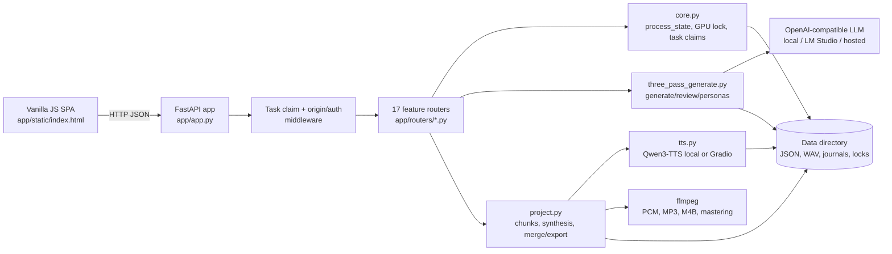
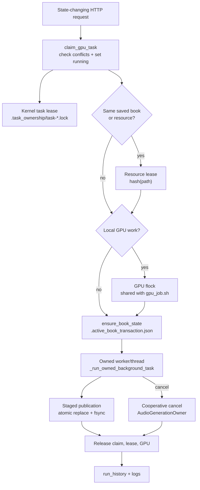
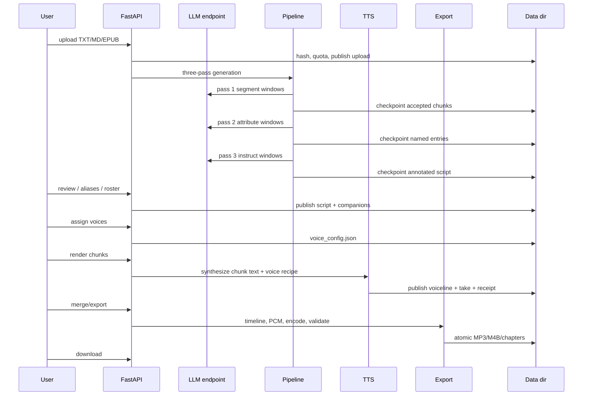
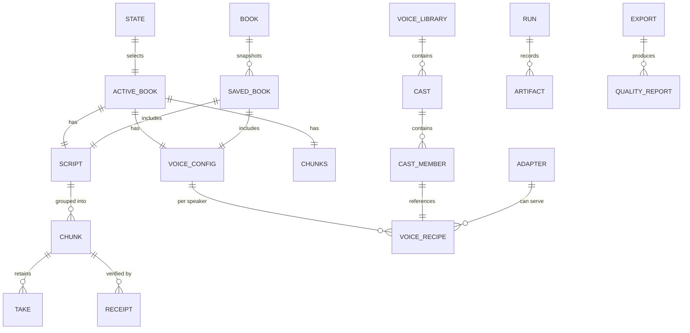

# Alexandria Audiobook2 — Codebase Knowledge

**Repository:** `alexandria-audiobook2`  
**Analyzed revision:** `c91bee0f` (`Repair incomplete Whisper builds on fresh installations (#1648)`)  
**Analysis date:** 2026-11-20  
**Method:** direct repository exploration, source reading, config/model inspection, and cross-checking against the committed docs. No live GPU, TTS, LLM, or full-corpus run was performed for this document; claims that depend on those are marked as documented/measured elsewhere in the repo.

This document is a self-contained brain dump for a new developer or another LLM. It answers three questions:

1. What does the application do, and why does each feature exist?
2. How do the pieces work and interact technically?
3. What must be understood before changing code safely?

---

## 0. How to read this document

- **New to the project:** read §1, §2.3, and §3.1–§3.7 in order.
- **About to change code:** read §4 first. It documents the invariants that fail silently when ignored.
- **Looking for a file or API:** jump to §5.
- **Reviewing architecture:** §2 and the diagrams in `codebase-analysis-docs/assets/`.

All repository paths in this document are relative to the repository root unless stated otherwise.

---

## 1. Executive summary

### 1.1 What the application is

Alexandria Audiobook2 (AA2) is a local-first, single-page web application that turns a book into a multi-voice audiobook.

Input:

- `.txt`, `.md`, or `.epub`.

Processing:

1. A language model annotates the book in three passes:
   - **Pass 1 — segment:** decide which text is narration and which is spoken dialogue.
   - **Pass 2 — attribute:** assign every spoken line to a speaker from a cast list, using surrounding evidence.
   - **Pass 3 — instruct:** write a delivery direction for every line.
2. The user reviews the script, resolves aliases, and assigns a voice to every character.
3. A text-to-speech engine (Qwen3-TTS locally, or an external Gradio TTS server) renders each chunk.
4. The user listens, edits, regenerates individual chunks, optionally checks voice drift and speech content.
5. The app assembles the chunks into MP3, chaptered M4B, per-chapter files, or an Audacity project.

The app also contains a voice-production toolchain ("Voice Lab") that turns existing audiobooks into aligned training data, trains LoRA voice adapters, evaluates them, and promotes them with an audit trail.

### 1.2 Business purpose and target users

The product's purpose is **high-quality, repeatable audiobook production on hardware the user owns**, with every important quality claim measured rather than asserted.

Primary users:

- Self-hosters running the app through Pinokio on a workstation with a GPU.
- Researchers who need reproducible prompt/model comparisons and a labelled evaluation corpus.
- Users producing series fiction, where cast reuse and voice continuity matter.
- Users who want to clone or train a specific narrator voice from an existing audiobook.

The fork explicitly differs from upstream Alexandria by adding:

- Three-pass script generation with checkpointing and recovery.
- Measured attribution prompt variants and attribution LoRA adapters.
- First-class reasoning-model support, LLM profiles, failover, and manual transport.
- A voice library/cast system, identity anchors, style timelines, voice drift checks.
- Voice Lab: preparer, deduplication, batch LoRA training, profiling, naming.
- Export quality gates, publication receipts, and measurable mastering.
- A large measurement corpus (`GOALS.md`, `RECIPES.md`, `RESULTS_INDEX.md`, `ab_test_runtime/experiments/`).

It is **not** a multi-tenant SaaS. It has no database, no job-queue service, and no built-in authentication unless the operator opts in. State is files in one mutable data directory, protected by kernel file locks and transaction journals.

### 1.3 Feature map

| Feature | User outcome | Main code |
|---|---|---|
| Setup / LLM profiles | Connect local or hosted OpenAI-compatible LLM; control reasoning, retries, failover | `app/config_settings.py`, `app/llm_provider.py`, `app/lmstudio_settings.py`, `app/routers/system.py` |
| Source ingestion | Upload/reuse TXT/MD/EPUB; normalize text; choose first-person narrator; preflight a sample | `app/routers/script.py`, `app/source_encoding.py`, `app/source_normalization.py`, `app/epub_package.py` |
| Three-pass generation | Produce the annotated script with resumable checkpoints | `app/three_pass_generate.py`, `app/generate_script.py`, `app/attribution_prompt_variants.py`, `app/pass_quality.py` |
| Script review | Fix attribution/text/delivery errors; optional labels-only mode; alias discovery | `app/review_script.py`, `app/review_prompts.py`, `app/find_nicknames.py` |
| Character identity | Approved roster of names/aliases with source-quote evidence and undo | `app/character_roster*.py`, `app/routers/character_roster.py` |
| Speaker-label review | Bounded, snapshotted second-opinion review of speaker labels | `app/speaker_review.py`, `app/routers/speaker_review.py` |
| Cast and voices | Assign CustomVoice/Clone/Voice Design/LoRA; personas; style timelines; voice library | `app/routers/voices.py`, `app/routers/voice_library.py`, `app/generate_personas.py`, `app/voice_reference*.py` |
| Editor / synthesis | Render chunks, edit, regenerate, check drift, restore takes, verify speech | `app/routers/editor.py`, `app/project.py`, `app/tts.py`, `app/synthesis_*.py`, `app/take_*.py`, `app/speech_verification*.py` |
| Export | MP3, M4B, chapter files, Audacity package, mastering, quality receipts | `app/project.py`, `app/export_*.py`, `app/m4b_*.py`, `app/audio_mastering*.py`, `app/routers/editor.py` |
| Sound design | Immutable sound cues, imported assets, renditions, mix candidates, delivery review | `app/sound_design_*.py`, `app/routers/sound_design.py` |
| Preparer | Audiobook → aligned (audio, text) training data | `alexandria_preparer_rocm_compatible.py`, `app/routers/preparer.py`, `alexandria_alignment.py` |
| Dataset / Training | Build synthetic training data; train and evaluate LoRA adapters | `app/routers/dataset_builder.py`, `app/train_lora.py`, `app/routers/lora.py`, `promote_adapters.py` |
| Voice Lab | Whole-library pipeline: ASR → dedup → train → profile → name | `app/routers/voicelab.py`, `tools/voice_lab/`, `app/voice_*.py` |
| Reports / benchmarks | Run history, review checkpoints, benchmark manifests | `app/run_history.py`, `app/routers/benchmark.py`, `app/benchmark_*.py` |
| Home workspace | Read-only readiness view and "continue where I left off" navigation | `app/routers/scripts_library.py`, `app/static/js/app-workspace.js`, `docs/workspace-readiness.md` |

### 1.4 Technology stack

| Layer | Technology |
|---|---|
| Backend | Python 3.10, FastAPI, Starlette, Uvicorn, Pydantic v2 |
| LLM protocol | OpenAI-compatible HTTP (`openai` client), llama.cpp/LM Studio/Ollama/DeepSeek/OpenAI/OpenRouter/Thunder-compute endpoints |
| TTS | Qwen3-TTS via local PyTorch, or external Gradio clients; LoRA/PEFT adapters |
| Audio DSP | pydub, soundfile, librosa, numpy, ffmpeg, parselmouth, speechbrain/ECAPA, pyannote (optional) |
| Frontend | Vanilla JavaScript, Bootstrap 5, no build step, DOM-driven polling |
| Persistence | JSON files, JSONL, WAV/MP3/M4B assets, filesystem locks, transaction journals |
| Packaging | Pinokio launcher (`install.js`, `torch.js`, `start.js`) plus Docker and Colab |
| Testing | `unittest`, browser-DOM fixture tests, live isolated API suite, release verifier, GitHub Actions shards |

Notable dependency constraints:

- `app/requirements.txt` deliberately does **not** pin `torch`; `torch.js` installs the platform-correct build first.
- `llama-cpp-python` is deliberately absent from `requirements.txt`; the PyPI wheel is CPU-only and would overwrite the HIP build used by Voice Lab.
- `app/app.py` does not import `torch`; GPU code is imported lazily so startup and CI remain CPU-installable.
- The frontend has no bundler. `app/static/index.html` loads a fixed ordered list of `app/static/js/app-*.js` files at global scope, and initialization happens at the end of `app/static/js/app-workbench.js`.

---

## 2. System architecture

### 2.1 Runtime topology



*Editable source: [`assets/architecture.mmd`](assets/architecture.mmd).*

The app is a modular monolith:

- One FastAPI process owns the API and static frontend.
- Long work runs in **background threads** and **owned subprocesses**, tracked in a process-local `process_state` registry.
- Cross-process safety is enforced by **kernel file locks** in the data directory, not by a database.
- The browser is a single-page app that polls task status endpoints; there is no WebSocket protocol.

Important entry points:

- `app/app.py:83` creates the FastAPI app and mounts static/data directories.
- `app/app.py:55` defines the lifespan startup/shutdown recovery sequence.
- `app/app.py:161-225` includes 17 feature routers.
- `app/app.py:228` runs Uvicorn on `ALEXANDRIA_HOST` / `ALEXANDRIA_PORT` (default `127.0.0.1:4200`).

### 2.2 Request and task lifecycle



*Editable source: [`assets/task-admission.mmd`](assets/task-admission.mmd).*

A typical state-changing request:

1. **Middleware**
   - `TaskClaimMiddleware` (`app/core.py:980`) gives each HTTP request a context-local claim list.
   - Optional Basic Auth (`app/app.py:111-128`) is enabled only when `ALEXANDRIA_AUTH_PASSWORD` is set.
   - `_request_origin_gate` (`app/app.py:141-150`) refuses cross-site mutations and DNS-rebinding hosts.
   - CORS is added last so preflights are answered and refusals are labelled.
2. **Route validation**
   - Pydantic models validate bodies and path parameters.
   - Book/source/identity tokens are checked.
   - Resource paths are resolved and checked for containment.
3. **Admission**
   - `claim_gpu_task` (`app/core.py:754`) atomically:
     - checks conflicting tasks,
     - acquires a kernel task lease in `.task_ownership/`,
     - acquires the GPU flock when local GPU work is needed,
     - sets `process_state[task]["running"]`.
   - `reserve_background_task` (`app/core.py:853`) reserves a *pending* claim; `register_claimed_background_task` binds it to the request. If the request dies before registration, the pending claim is released.
4. **Execution**
   - `_run_owned_background_task` (`app/core.py:940`) marks the claim started, wraps audio/export work in an `AudioGenerationOwner`, runs the callback, and releases the claim in `finally`.
5. **Publication**
   - Outputs are written to staging and atomically moved into place.
   - Quality/identity checks run before the move.
   - Run history and receipts are updated.

The `process_state` registry (`app/core.py:555-586`) is the in-process source of truth for UI status. It is **not** shared across processes. Cross-process truth is the lock files plus on-disk journals.

### 2.3 Book-to-audiobook data flow



*Editable source: [`assets/book-flow.mmd`](assets/book-flow.mmd).*

1. **Upload / select**
   - `POST /api/upload` streams to a temporary path, enforces a 512 MiB per-file bound and an 8 GiB upload-store bound, hashes the file, reuses an identical upload, and publishes the active-book switch through `book_state_transaction`.
   - EPUB text is extracted with TOC titles inserted when available.
2. **Preflight**
   - The source is decoded, normalized, scanned for unsafe Unicode/replacement characters, and sampled through the LLM pipeline.
   - The result is evidence about *this sample*, not a guarantee for the whole book.
3. **Three-pass generation**
   - `three_pass_generate.run_three_pass` produces `[{speaker, text, instruct}]`.
   - A durable checkpoint (`annotated_script.json.threepass_checkpoint.json`) records the fingerprint, completed chunks/windows, and accepted entries.
   - The final script is published atomically; a run whose LLM disappears refuses to publish fallback output.
4. **Review and identity**
   - Review may rewrite text/attribution/instructions (full-text mode) or only labels (labels-only mode).
   - Aliases and the approved character roster change future generation input, not already accepted lines unless the user explicitly applies a repair.
5. **Casting**
   - `voice_config.json` maps each speaker to a voice recipe.
   - Voice library casts can be saved/applied across books.
6. **Chunking**
   - `ProjectManager` converts the script into render chunks (`chunks.json`), assigning each a stable `uid`.
   - A chunk is the unit of synthesis, editing, drift checking, and take history.
7. **Synthesis**
   - `TTSEngine` renders a chunk to a temporary WAV, validates it, and publishes it under `voicelines/<uid>.<ext>`.
   - Speech verification (optional ASR) can compare returned audio to the intended text.
8. **Assembly/export**
   - Export computes a timeline with pauses/trims, spools PCM, encodes, validates the output plan, and atomically publishes the file.
9. **Delivery**
   - MP3, M4B, chapter files, Audacity zip, and sound-design mixes are exposed through download routes with identity checks.

### 2.4 Data and identity model

There is **no database**. The data directory is the database.

Default data root: the repository root, unless `ALEXANDRIA_DATA_DIR` is set (`app/utils.py:41-44`). Config placement follows a legacy rule: `app/config.json` when the data root is the repo root, otherwise `<data_dir>/config.json` (`app/utils.py:47-51`).



*Editable source: [`assets/data-model.mmd`](assets/data-model.mmd).*

Core persistent objects:

| Object | Path | Notes |
|---|---|---|
| App config | `app/config.json` or `<data>/config.json` | Machine-local, gitignored; may contain API keys; GET redacts secrets |
| Active script | `annotated_script.json` | JSON array of `{speaker,text,instruct}` plus optional metadata |
| Active voices | `voice_config.json` | Per-speaker voice recipe/versions/timeline |
| Chunks | `chunks.json` | Render state; `uid` is stable across insert/delete |
| Chunk audio | `voicelines/` | Referenced by chunk `audio_path` |
| Character aliases | `character_aliases.json` | Alias → canonical mapping |
| Voice library | `voice_library.json` | Shared/cast voice pools, favorites, assignments |
| Saved books | `scripts/<name>.json` and companions | Script, voice config, aliases, sound design sidecars |
| Uploads | `uploads/` | Reusable source files, quota-accounted |
| Reports | `reports/` | Markdown review reports |
| Logs | `logs/api/` | Per-task latest logs |
| Run history | `run_history/` | One JSON record per run with artifact hashes |
| Task locks | `.task_ownership/` | Kernel leases, resource locks, admission barrier |
| Book transaction | `.active_book_transaction.json` + `.book-switch-*` | Crash-recoverable active-book publication |
| Export staging | `export_staging/` and per-format staging | Temporary outputs, reclaimed on startup/export |
| Voice assets | `lora_models/`, `builtin_lora/`, `designed_voices/`, `clone_voices/` | Adapters and references |
| Evaluation evidence | `ab_test_runtime/experiments/`, `docs/results/` | Measurement artifacts, not runtime state |

Identity rules that recur throughout the code:

- **Book identity:** a stable `active_book_id` in `state.json`, derived from the selected upload/saved book; book tokens/digests bind operations to a specific source, script, voice config, and companion bytes.
- **Chunk identity:** `chunk["uid"]` is assigned once and never renumbered. `chunk["id"]` is positional and *does* change on insert/delete; never use it as a stable filename or evidence key.
- **Generation-input identity:** a subset of chunk fields (`CHUNK_GENERATION_FIELDS` in `app/project.py`) plus pronunciation rules. Changing any of them makes previous audio stale.
- **Asset identity:** SHA-256 of bytes, plus filesystem version fields (`st_dev`, `st_ino`, `st_size`, `st_mtime_ns`, `st_ctime_ns`) where TOCTOU matters.
- **Fingerprints:** checkpoint identities include source, model, params, prompt variant, cast hash, and pipeline settings. A changed input must not silently resume an old checkpoint.

### 2.5 Concurrency, admission, and recovery

This is the most important architectural subsystem to understand before changing code.

#### Layers

1. **Request claim** — binds a pending task reservation to the HTTP request (`TaskClaimMiddleware`). Prevents a client disconnect from leaking a reservation.
2. **Task lease** — `.task_ownership/task-<name>.lock`, an exclusive kernel lock. A conflicting task name cannot start in *any* process. `acquire_task_lease` also probes conflict slots and resource slots under an `admission` lock (`app/task_ownership.py:138-166`).
3. **Resource leases** — per-path hash locks, used when two operations must not mutate the same saved book or artifact.
4. **GPU flock** — the shared lock used by both the app and `gpu_job.sh`/experiments. `app/experiments/gpu_guard.py` deliberately refuses to run beside a queue job unless the caller inherited the lease or sets `ALEXANDRIA_ALLOW_CONTENTION=1`.
5. **Book transaction** — `.active_book_transaction.json` serializes whole-book switches and provides crash recovery.
6. **Per-file locks** — `utils.file_lock`, with timeout and stale handling, for JSON read-modify-write operations.

#### Conflict policy

`app/core.py:588-600`:

- `NON_GPU_TASKS = {"audacity_export", "m4b_export", "drift_check", "chapter_export"}`.
- `GPU_TASKS` is every registered task except those.
- `LLM_TASKS` are tasks whose accelerator use is only the LLM endpoint.

When the active LLM profile is **not** on this machine's GPU (`llm_is_on_this_gpu()` returns false), LLM-only tasks contend with each other but may run alongside TTS/audio work. When it is local, or when the config cannot be read, the full GPU lock applies. This is a deliberate safety default.

#### Startup recovery

`app/app.py:55-80`:

1. `ensure_startup_recovery(DATA_DIR)` scans every task lock and yields only when none is held. If another worker owns work, startup preserves state rather than "fixing" it.
2. With no live owner:
   - `ensure_book_state` recovers an interrupted active-book transaction.
   - Abandoned synthesis workspaces are cleaned.
   - Export staging is reclaimed.
   - `generating` chunks are reset to `pending`.
   - Unfinished run-history records are marked interrupted.
   - Abandoned evaluation-review sessions are pruned.

This is why a stale `.lock` file is not automatically deleted: the lock's *held* state, not its existence, is the authority.

#### Cancellation

Cancellation is cooperative:

- UI routes set `process_state[task]["cancel"] = True`.
- Workers check cancellation at safe boundaries.
- `AudioGenerationOwner` prevents a cancelled/foreign audio task from publishing after cancellation.
- Subprocesses are owned and terminated as process trees (`app/subprocess_ownership.py`, `app/windows_subprocess_owner.py`, `app/macos_subprocess_owner.py`).

### 2.6 Security and trust boundaries

The app is designed to bind to loopback and be used by one operator.

Controls present in the code:

- **Bind address:** default `127.0.0.1` (`app/app.py:230`).
- **Optional Basic Auth:** only registered when `ALEXANDRIA_AUTH_PASSWORD` is set; every non-OPTIONS request is checked. CORS preflights are allowed through so they can be answered.
- **Origin/Host gate:** cross-site state-changing requests are refused (`403`), and unknown DNS names are refused (`400`) to stop DNS rebinding. Loopback/private-network clients, `localhost`, `*.localhost`, and clients with no `Origin`/`Referer` are allowed. Override with `ALEXANDRIA_ALLOWED_ORIGINS` / `ALEXANDRIA_ALLOWED_HOSTS`.
- **CORS:** default origins are localhost; configurable via `CORS_ORIGINS`.
- **Path containment:** `is_path_inside` + realpath checks in uploads, saved books, exports, adapters, and staging.
- **Upload limits:** 512 MiB per script upload, 8 GiB total upload storage, bounded EPUB/text decoding, bounded archive member handling.
- **Secret handling:** API keys may be `env:NAME` references. `GET /api/config` redacts keys. Config save restores redacted placeholders instead of overwriting real secrets. Logs/headers are redacted in several modules.
- **LLM endpoint locality:** `_validate_local_llm_base_url` permits loopback/private endpoints, plus an explicit allowlist of hosted providers (DeepSeek, OpenAI, OpenRouter) and `*.thundercompute.net`; arbitrary public endpoints are refused.
- **Process ownership:** subprocesses are started with leases and can be stopped as trees; Windows uses job objects, macOS uses a native owner protocol.
- **No telemetry:** no analytics/billing API integration. Remote LLM cost is warned about, not computed.

Residual risks an operator must understand:

- Default auth is **off**. Exposing the app beyond localhost without `ALEXANDRIA_AUTH_PASSWORD` is unsafe.
- Hosted LLM configuration sends book text to that provider. The app warns before remote batch runs, but does not enforce a data-egress policy beyond endpoint validation.
- The app's own local files are not encrypted.

### 2.7 Logging and observability

- **Task logs:** `process_state[task]["logs"]` is the live tail; `logs/api/<task>-latest.log` is the on-disk log. `GET /api/status/<task>` returns the live status; `GET /api/logs/<task>` serves the full log.
- **LLM request logs:** `logs/review_responses.log` (rotated) records requests/responses, finish reasons, token counts, and elapsed time. Request metadata is also written separately.
- **ETA:** `_compute_eta` (`app/core.py:1043`) prefers the pipeline's own `ETA: ... [eta_seconds=... fraction=...]` line, then falls back to the last `N/M` marker. Batch tasks fold per-item progress into the overall fraction.
- **Run history:** `app/run_history.py` stores one record per run with `status`, timestamps, error, and artifacts. Artifacts record SHA-256, size, declared sources, and config bytes. Hashes describe bytes at recording time; they are not a permanent authenticity proof.
- **Reports:** review/batch runs write Markdown reports under `reports/`; the UI can request an LLM-generated plain-language summary, with guards against unsupported completeness/quality claims.
- **Version:** `GET /api/status/version` reports the commit the running process is actually executing. The UI warns when the served build differs.
- **Benchmarks:** manifests and artifacts under `ab_test_runtime/experiments/`, indexed by `RESULTS_INDEX.md`.

### 2.8 Packaging and runtime

Pinokio launcher:

- `install.js` creates `app/env`, runs `torch.js` for the platform-correct PyTorch, installs Python requirements, builds `llama-cpp-python` and `whisper.cpp` for the detected GPU, and provisions the AI bundle.
- `start.js`:
  - allocates a port via `{{port}}`,
  - stores it in `local.port`,
  - runs `python app.py` under `app/env` with `ALEXANDRIA_PORT`,
  - captures the URL from Uvicorn's successful bind message,
  - breaks visibly on import/bind/startup errors.
- `torch.js` is the only place that installs torch; `app/requirements.txt` must not pin it.
- `Dockerfile`/`docker-compose.yml` exist for NVIDIA; compose publishes on `127.0.0.1`.
- `alexandria_colab.ipynb` provides a free-T4/ngrok path.

The app can run without Pinokio in any Python environment that satisfies `app/requirements.txt` and has the right torch build, but the launcher is the supported installation path.

---

## 3. Feature-by-feature analysis

### 3.1 Setup, configuration, and LLM provider layer

**Purpose:** let the user connect an OpenAI-compatible LLM and control cost, latency, determinism, and failure behavior without editing files.

**Configuration model** (`app/config_settings.py`):

- `AppConfig` contains:
  - `llm` (mirror of the active profile for legacy consumers),
  - `llm_mode` (`local`/`remote`),
  - `llm_local`, `llm_remote` (full `LLMConfig` each),
  - `llm_remote_ssh`,
  - `llm_failover`,
  - `tts`,
  - `prompts`,
  - `prompt_presets`,
  - `generation`.
- `LLMConfig` includes base URL, API key, model name, context/input/output limits, custom headers/body, `on_this_gpu`, transport (`http`/`manual`), reasoning effort, timeouts, retry policy, API-exhaustion policy (`fail`/`pause`), structured output, and backoff/jitter.
- `TTSConfig` includes mode, URL/pool, device, language, workers, seed, reproducible takes, synthesis windows, synthesis recovery, speech verification, codec compile, max tokens, sub-batching, pause defaults, and voice-design text bounds.
- `GenerationConfig` includes chunk size, sampling params, context rescue, per-pass temperatures, pass-2/3 context/character budgets, prompt variant, segmentation mode, pass-1 format, delivery direction, group/speaker-traits flags, and per-model profiles.
- `PromptConfig` / `PromptPreset` store user-editable attribution/review/pass-1/pass-3 prompts.

**Key invariant:** `config["llm"]` is a **mirror**, not the source of truth. `get_active_llm_config` (`app/lmstudio_settings.py:188`) reads `llm_<llm_mode>` first and falls back to `llm` only for old configs. Writing to `config["llm"]` without updating the selected profile causes the app to dial a stale endpoint. This is documented in the function itself after a real incident.

**Provider layer** (`app/llm_provider.py`):

- `ConfiguredOpenAI` wraps the OpenAI client with custom headers/body, timeouts, and request pacing.
- `make_llm_client` builds a profile client.
- `make_run_client` wraps the primary in a `FailoverClient` when `llm_failover` is on and the other profile is fully configured.
- `FailoverClient` is **sticky**: after a rate limit/5xx/timeout it switches to the secondary for the rest of the run, logs the switch, substitutes the secondary model name, and reads the secondary runtime's context/parallel limits before serving.
- `ManualClient` implements "the user is the model": each request is written to `manual_llm/pending.json`; a matching `response.json` is polled; retries and validation are unchanged. It deliberately has no timeout.
- `classify_llm_error`, `get_retry_delay`, and the request-budget modules decide retries and token sizing.

**LM Studio/llama.cpp integration** (`app/lmstudio_settings.py`):

- Detects local/remote LM Studio, model/context/parallel status, GPU name/backend, and the `lms` CLI.
- Can pin "ideal" VRAM-safe settings (`parallel: 1` locally) and restore them.
- `get_llama_cpp_status` probes llama.cpp's `/props`/`/v1/models`; `llama_server_process.py` manages a local llama-server lifecycle.
- Remote status is cached with epochs/aliases and parsed from the last non-empty line of SSH output (the remote banner is noisy by design).

**Routes:** the `routers/system.py` router covers config preview/save, model listing, LLM test, LM Studio status/optimize, system stats, ETA, run history, prompts, version, and config recovery.

**Edge cases:**

- A profile with a remote endpoint but missing limits inherits global limits; do not write inherited values back as overrides.
- On any failure to read the config, `llm_is_on_this_gpu()` returns `True` (conservative full GPU lock).
- `on_api_exhaustion="pause"` freezes the run for operator intervention instead of failing the chunk.
- Structured output is `auto` by default; a server that rejects the schema causes a one-time fallback for the run.
- Failover is off by default because the secondary may be a billed endpoint.

### 3.2 Source ingestion and book identity

**Purpose:** accept a book safely, normalize it, let the user preflight it, and make "which book is active" explicit and crash-safe.

**Upload path** (`app/routers/script.py`):

- `POST /api/upload` validates extension, streams with a limit, hashes, reuses exact duplicates, and publishes the upload under `uploads/`.
- EPUB extraction (`extract_epub_text`) reads EPUB3/EPUB2 TOCs and XHTML, inserts TOC titles where appropriate, and normalizes extracted text.
- Selecting an existing upload (`POST /api/uploads/select`) or a saved book goes through `apply_book_input_selection` / `ensure_book_state`.

**Book transaction** (`app/book_state_transaction.py`):

- All active-book artifacts (script, voice config, chunks, aliases, sound-design companions) are staged in a `.book-switch-*` workspace.
- A journal records each path, whether it existed, and old/new SHA-256.
- Publication uses `os.replace` + directory fsync; recovery validates every original and replacement before restoring anything.
- Destructive recovery refuses if a target changed after the journal was written.
- The transaction is held under `.active_book_transaction.json` file lock.

**Switch admission** (`app/core.py:718-740`):

- Book switches refuse while any task is running or another process owns a task.
- Startup recovery must have no live owner.
- The lock is held through publication; some long scans can release the local mutex while the kernel admission barrier still excludes tasks.

**Preflight:**

- `start_book_preflight` runs a bounded sample through the pipeline (not just "does the LLM answer") and returns a job-scoped report.
- It distinguishes "the sample worked" from "the whole book will work"; the UI says so.
- It checks source Unicode/replacement issues, source identity, and request sizing.

**Edge cases:**

- Uploading a file does not by itself guarantee it is safe to publish; the source normalization and encoding gates run first.
- EPUBs with malformed archives/paths are rejected rather than followed.
- `uploads/` quota is global; duplicate uploads reuse the existing file.
- `state.json` stores the active book id, but the canonical identity can also be derived from the selected input path.

### 3.3 Three-pass script generation

This is the core IP of the fork and the most complex pipeline.

**Purpose:** convert raw prose into a speakable script with correct speaker attribution and per-line delivery, in a way that is resumable, auditable, and resistant to model failure.

**Orchestrator:** `app/three_pass_generate.py` (`run_three_pass`, line 2617).

#### Planning and preflight

- `resolve_three_pass_generation_settings` (`:141`) merges:
  - shipped per-model profiles (`three_pass_model_profiles.json`),
  - user `config.json` overrides,
  - CLI overrides.
- It resolves chunk size, token limits, segmentation mode, pass-1 format, attribution variant, batch sizes, context budgets, and delivery direction.
- `is_three_pass_context_required` (`:202`) decides whether a known context length is mandatory for large targets.
- `get_three_pass_planned_calls` / `build_three_pass_request_preflight` estimate calls and context fit before a run.
- `get_three_pass_preflight_capacity` compares planned calls to the endpoint's parallel capacity.

#### Pass 1 — segment

- Source is split into chunk records (`get_segment_chunk_records`, `:1890`) with safe cut points.
- Quote analysis (`analyze_outer_quote_regions`) tracks quote depth across chunks.
- `quote_regions_decision` chooses per chunk:
  - `auto`: quote marks where unambiguous, model otherwise,
  - `quotes`: quote marks only,
  - `lexical`: quote-aware lexical analysis,
  - `llm`: model only.
- Chunks that need the model go through `segment_chunk_adaptively` (`:1734`):
  - validates output against the source,
  - splits failed chunks and retries (`split_failed_chunk`),
  - can rescue with surrounding source context (`rescue_chunk_with_context`),
  - supports compact pass-1 labels with fallback.
- Every accepted chunk is checkpointed. The resolution (`quote`, `model`, `compact`, `fail`, etc.) is recorded for telemetry.
- A chunk that exhausts retries either:
  - fails the run (`on_exhaustion="fail"`), or
  - is kept as an explicitly flagged/diagnostic result in `collect_all_failures` mode.

#### Pass 2 — attribute

- Entries are grouped into windows (`iter_unique_entry_batches`), default 25 entries.
- The roster is built from accepted entries and cast (`build_roster`), with alias groups.
- `attribute_batch` (`:940`) / voted variants:
  - builds the prompt through `attribution_prompt_variants`,
  - validates that every expected index appears exactly once,
  - validates names against the roster/source evidence,
  - detects attribution shifts and source-tag confusion,
  - supports `keep_scope="line"` (per-line fallback) or `"batch"` (keep a whole accepted batch),
  - supports `attribution_votes > 1` with a vote temperature,
  - supports speaker traits (gender/age) as an optional extra output.
- Request sizing:
  - `build_window_surround` shows a configurable amount of surrounding text (default 2,000 chars; the `michel2_full` shape),
  - `wrap_window_surround` and `get_missing_attribute_contexts` handle neighbors,
  - `does_request_fit_context` rejects or subdivides requests that exceed the model context.
- On exhaustion:
  - a multi-entry window is split in half and retried,
  - a single entry is either failed or recorded as a diagnostic failure,
  - if every attempt was an API error, the run refuses fallback output.
- Narration entries are filled deterministically as `NARRATOR`; the model is never allowed to overwrite a known narration speaker.
- Accepted entries are checkpointed after each window.

**Prompt variants** (`app/attribution_prompt_variants.py`):

- Variants change only the user-facing question, not the output contract.
- `michel2_full` is the default (whole window plus surrounding evidence).
- `michel2_spoken` asks only about spoken indexes and fills narration deterministically; measured on one base model, not yet default.
- `continuity` maintains a rolling story summary.
- `judge` requests a reason per line for audit.
- Variants are coupled to measurement: a score belongs to its variant, and an attribution adapter should be served with the prompt it was trained on.

#### Pass 3 — instruct

- Entries are batched by count/target characters.
- Non-verbal entries get a deterministic default instruction.
- `instruct_batch` (`:1141`) validates that every entry receives a string instruction.
- `build_instruct_surround` supplies optional context.
- Delivery direction (`off`/`gaps`/`directed`/`action_only`) can add reply-aware notes; it requires the default pass-3 prompt.
- A failed window is subdivided; single-entry failure is retried or recorded.
- Accepted instructions are checkpointed.

#### Checkpointing and publication

- `three_pass_fingerprint` (`:2403`) binds the source, model, chunk size, params, prompt variant/texts, cast hash, votes, narrator, traits, and target contexts.
- `_load_three_pass_checkpoint` refuses a fingerprint mismatch.
- Checkpoints include per-chunk resolutions, accepted entries, elapsed time, diagnostic failures, and model binding.
- `GenerationCheckpointDeltas` writes incremental deltas so a crash does not corrupt the whole checkpoint.
- `get_generation_checkpoint_path` / `emit_manifest` also produce a quality manifest and a recovery manifest.
- On final publication, `publish_completed_generation` validates output path and source identity.
- If the LLM becomes unavailable for a pass, the run raises instead of publishing partially attributed output.

**Output format:**

```json
[
  {"speaker": "NARRATOR", "text": "The rain had not stopped for three days.", "instruct": "Low, steady, unhurried."},
  {"speaker": "MARA", "text": "We should turn back.", "instruct": "Tense, quiet, near a whisper."}
]
```

- `speaker` is `NARRATOR`, a canonical character name, or `UNKNOWN`.
- `text` is exactly what is spoken; quote marks are removed and attribution tags are narration.
- `instruct` is the delivery direction.

**Edge cases that matter:**

- A source edit invalidates checkpoint identity; the UI must offer "start over" or a matching resume, never silently reuse.
- `UNKNOWN` is a legitimate model output and is resolved later via review/aliases, not treated as a crash.
- A model can return valid JSON with wrong text; the source/coverage gates reject it.
- Reasoning tokens count against the budget even when the provider does not report them; the pipeline estimates from the trace.
- At temperature 0, re-sending an identical rejected prompt is pointless; the retry policy tracks attempted prompts.
- Long books are intentionally processed in windows; memory is bounded by chunk/window, not book size.

### 3.4 Review, aliases, character roster, and speaker-label review

**Purpose:** improve attribution and text quality without destroying accepted work, and make identity decisions explicit.

#### Review script (`app/review_script.py`)

- Full-text mode asks the model to fix:
  - attribution tags wrongly kept in dialogue,
  - narration wrongly assigned to a character,
  - over-split narrator lines,
  - delivery instructions.
- `review_batch` validates:
  - source binding,
  - text-loss ratio,
  - index/label shape,
  - speaker legality,
  - partial-label retention.
- Contextual review shows ±N neighboring entries.
- Batch review can process many saved books, optionally discover nicknames first and run forward/backward passes.
- Review checkpoints store the source hash, batch progress, and accounting so a resumed run cannot double-count edits.

**Labels-only mode** (`docs/features/labels-only-review.md`):

- The model returns only `{n, speaker, instruct}`.
- Code binds labels onto deep copies of the original entries, preserving exact text and boundaries.
- This avoids losing speaker fixes when the model changes punctuation.
- It cannot split/merge entries; full-text review remains available for structural changes.
- It has its own prompt and receipt marker, so a full-text completion cannot satisfy a labels-only run.

#### Aliases and nicknames

- `find_nicknames.py` scans the working script and proposes alias groups.
- `character_aliases.json` maps alias → canonical.
- `speaker_identity.py` normalizes/validates identities, prevents illegal merges, and stabilizes names.
- The shared registry can affect other books; applying an alias is an explicit, audited action.

#### Character roster (`character_roster*.py`, `routers/character_roster.py`)

- A snapshot-bound review of names, aliases, and source-quote evidence.
- Supports add, rename, merge, split, retire, import/export.
- Every quote is anchored to a source revision; coordinates are Unicode code points in prepared text (not bytes or UTF-16).
- Approval writes stable character IDs and projects names/aliases into the cast for *future* generation.
- It does not rewrite accepted lines or invalidate audio; explicit speaker repair is a separate action.
- One exact undo record is persisted. Undo refuses if the book/source/cast/roster or protected assets changed.
- Admission uses the book transaction and task ownership; a changed input refuses publication.

#### Speaker-label review (`speaker_review.py`, `routers/speaker_review.py`)

- Compares current/checkpoint labels against a saved reference for the same text.
- Previews evidence without model calls.
- Explicitly starts a bounded review (max pairs, max attempts) with no hidden retries.
- Results are provisional; an alias can be applied only when both judgments explicitly agree and the backend accepts the pair.
- Applies one alias to the shared registry; it does not rewrite the script or regenerate audio.
- Snapshot changes make old evidence stale and stop further requests.

**Feature interactions:**

- Review changes the script → chunk generation inputs change → old audio is stale.
- Alias/roster changes affect future generation and speaker repair, not already accepted lines.
- Roster approval can invalidate an in-flight generation checkpoint because the cast hash changes.
- Speaker-label review never auto-applies.

### 3.5 Casts, voices, personas, and voice assets

**Purpose:** assign a distinct, stable voice to every character, reuse casts across books, and keep voice identity from drifting.

**Voice config shape** (`voice_config.json`):

```json
{
  "NARRATOR": {
    "voice": "Ryan",
    "seed": -1,
    "character_style": "Warm, measured narrator.",
    "description": "...",
    "ref_audio": "clone_voices/...",
    "ref_text": "...",
    "adapter_id": "...",
    "adapter_path": "lora_models/...",
    "versions": {"...": {}},
    "active_version": "...",
    "style_timeline": [{"from_index": 120, "character_style": "Older."}]
  }
}
```

**Voice types** (`app/tts.py`):

- **CustomVoice:** preset speaker + `instruct`; `anchored_instruct` puts the identity anchor before the line's emotion.
- **Clone:** required reference WAV (3–30 s, normalized 24 kHz mono) + transcript; import validates duration, clipping, silence, peak, and records provenance/rights.
- **Voice Design:** text description → reference voice; saved designed voices become clone references.
- **LoRA:** local adapter bundle; serving identity includes adapter generation SHA-256 and merged prompt; external mode reports unsupported before model load.
- **Alias:** maps one speaker to another's config; still resolved to a canonical speaker at render time.

**Identity anchor and style timeline:**

- `character_style` is a constant anchor added at render time.
- `style_timeline` changes the anchor from a given chunk index onward.
- `active_character_style` (`app/tts.py:227`) selects the active point; `active_version_id` selects a voice version per chunk.
- These are book-specific and are stripped when a cast is saved to the library (`get_portable_voice_config`).

**Personas** (`app/generate_personas.py`):

- The LLM reads book evidence and writes a character description.
- Voice Design renders a reference; the design becomes a clone voice.
- Default scope is "only characters without a voice yet"; saving current voices to the library first is optional.
- Validation rejects aliases/personas that are not grounded in evidence or that target rejected identities.

**Voice library / casts** (`app/routers/voice_library.py`):

- `shared` pool contains narrator-like reusable voices.
- Each cast has members with configs, assignments, line counts, traits, and provenance.
- Import/export of casts is not a raw JSON merge: entries are portable configs plus book-scoped assignment metadata.
- Apply can target the current book or multiple saved books; audio invalidation follows the existing chunk-input rules.
- Fuzzy matching proposes character→member mappings; the user confirms.
- Favorites influence suggestions.

**Voice drift and suggestions:**

- `voice_drift.py` compares rendered chunks to the speaker's reference with ECAPA embeddings (CPU-pinned), flags outliers, and preserves evidence.
- `suggest_voices` matches downloaded LoRA voices to characters from traits/evidence; it is deliberately a GPU/LLM task.
- `voice_reference.py` maintains the speaker model and reference cache.

**Designer and clone imports** (`routers/voice_design.py`, `voice_reference_import.py`):

- Voice Design preview/save/list/delete.
- Clone upload stores the normalized WAV, measures it, records source/rights/provenance, and refuses invalid audio.
- The library and designer both rely on path containment and bounded uploads.

### 3.6 Editor, synthesis, takes, and speech verification

**Purpose:** make each chunk listenable, editable, regenerable, and verifiable without re-rendering the book.

**Chunk model** (`app/project.py`):

- `group_into_chunks` (`:617`) turns script entries into chunks:
  - splits on unspeakable content/scene breaks,
  - computes character limits by language (e.g., CJK limits differ),
  - retains source entry indices,
  - assigns a stable `uid`,
  - carries narrator/chapter/pause metadata.
- `get_chunk_generation_inputs` (`:169`) defines what invalidates audio: speaker, text, instruct, pause, pronunciation rules, and related fields.
- `chunks.json` is the render state; `ChunkStatusJournal` records status transitions for crash recovery.
- Chunk insert/delete renumbers `id` but not `uid`; audio filenames use `uid`.

**Synthesis engine** (`app/tts.py:836`):

- Local Qwen3-TTS models are lazily loaded per voice family: custom, clone, design, LoRA.
- External mode connects to one or more Gradio TTS servers; each `(url, worker)` gets its own client and lock.
- `get_chunk_voice_inputs` / `voice_config_for_chunk` resolve aliases, versions, style timeline, and pronunciation context.
- Seeds:
  - `batch_seed` or per-chunk seed,
  - `reproducible_takes` derives a seed from text + take.
- VRAM-aware sub-batching:
  - `_estimate_max_batch_size` computes KV-cache bytes from model dimensions,
  - `_build_sub_batches` splits by item cap, length ratio, and minimum size,
  - batch order is configurable.
- `torch.compile` for the codec is optional and only applied where useful; ROCm gets a dynamo reset to avoid guard accumulation.
- Local models are released when idle; `ensure_idle_local_models_released` prevents GPU work from starting while a model is still serving.

**Single and batch generation:**

- `ProjectManager.generate_chunk_audio` (`:1910`) freezes the chunk, resolves the voice, optionally applies pronunciation context, renders to a temp WAV, validates it, and publishes it.
- `generate_chunks_parallel` (`:3181`) and `generate_chunks_batch` (`:3532`) coordinate batches, progress, cancellation, and per-chunk errors.
- `routers/editor.py` exposes single generate, batch generate, fast batch, cancel, and per-chunk edit/insert/delete/restore.
- Audio publication uses `AudioGenerationOwner` + `take_publication` receipts so a cancelled/foreign task cannot overwrite a newer take.

**Synthesis recovery and windows:**

- `synthesis_windows.py` splits long text at safe seams (`plan_synthesis_windows`) and assembles audio from independently rendered windows.
- `synthesis_recovery.py` / `synthesis_recovery_*` capture model, serving, code, and asset identity so a recovered synthesis can prove it used the same inputs.
- `synthesis_workspace.py` owns temporary working files and cleans them after success or crash.
- `synthesis_audio.py` validates PCM shape, seams, silence, and joins.
- The design is explicitly about **proof and bounded recovery**, not just retry sugar.

**Speech verification** (`speech_verification*.py`):

- Optional ASR verification compares generated audio to the intended text.
- Runtime/model identity is recorded; primary and confirmation verifiers must be distinct.
- `speech_verification_compare.py` handles tokenization, numeric ambiguity, and corroboration.
- `speech_verification_receipt.py` binds the receipt to the chunk, book token, revision, speech input, and audio file version.
- Failures can be recorded and retried; stale receipts are refused.

**Take history** (`app/take_*.py`, `audio_take_history.py`):

- Every successful render can be retained as a take version with metadata, audio, and generation context.
- Policy config controls retention.
- Restore validates the target, the current chunk identity, the take record, the speech receipt, and the generation proof.
- Deletion/cleanup is bounded and refuses to remove referenced assets.
- The editor exposes list/audition/restore/delete.

**Drift check:**

- `routers/editor.py` `drift_check` scores finished chunks against the speaker reference.
- It runs as a CPU task (ECAPA pins CPU), exempt from the GPU lock.
- Results are advisory flags; they do not rewrite audio.

**Word timing:**

- `word_timing.py` aligns chunk audio to words for word-level highlighting/editing.
- CPU-only, bounded by the existing audio snapshot limits.

**Pronunciation:**

- `pronunciation.json` plus per-chunk occurrence rules rewrite text at render time.
- `speech_text.py`, `speech_numbers.py`, `verbalization.py`, `comma_pauses.py` handle normalization/verbalization.
- Occurrence rules are revision-bound and included in generation inputs.
- The pronunciation panel supports global rules, occurrence-specific edits, previews, and auditions.

### 3.7 Export, mastering, publication, and sound design

**Purpose:** turn chunk audio into deliverable files without silently shipping truncated, corrupt, stale, or wrong-scope audio.

**Merge/assembly** (`app/project.py`):

- `merge_audio` (`:2143`) produces `cloned_audiobook.mp3` (128 kbps).
- `merge_m4b` (`:2372`) produces `audiobook.m4b` with chapter markers, tags, and optional cover.
- `export_chapters` (`:2943`) writes per-chapter MP3/WAV with filename templates, selection, changed-only reuse, and a manifest.
- `export_audacity` (`:2225`) writes per-speaker WAV tracks, a `.lof` project file, and `labels.txt`.
- All paths:
  - capture source identities before decoding,
  - spool PCM rather than retaining the whole book,
  - use staging directories,
  - validate the encoded output against the plan,
  - verify sources did not change,
  - atomically publish,
  - notify quality/mastering callbacks.

**Export quality** (`app/export_quality.py`):

- A plan describes expected frames, sample rate, channels, format, pauses, chapters, and tags.
- The encoded file is decoded/probed and compared to the plan.
- Reports record codec/container, duration, channels, bitrate, chapter expectations, and hashes.
- `ExportSourceSnapshot` binds the chunks and source files at capture time; `verify_sources()` refuses if they changed.
- `ensure_export_stage_current` refuses if staging or output changed under the operation.
- Failed validation leaves the prior good output intact.

**Mastering** (`app/audio_mastering*.py`):

- Optional loudness normalization (default target -18 LUFS, -2 dBTP; bounds -24..-14 LUFS, -9..-1 dBTP).
- Measures before/after; reports mode (linear/dynamic), true peak, LRA, and output SHA-256.
- Applies only to the assembled deliverable; source clips and Audacity tracks are unchanged.
- Each FFmpeg phase has a finite timeout; failures are visible and do not replace a prior good file.

**M4B specifics:**

- Metadata tags: title, author, narrator, year, description.
- Cover image validation (bytes, dimensions, pixel budget, trailing payload).
- Chapters derive from source-group boundaries, not arbitrary chunk indices.
- AAC encode is bounded by duration-derived timeout; `+faststart` for streaming.

**Chapter export:**

- Template fields include chapter number/title/book/series/volume.
- Duplicate filenames are rejected, not silently overwritten.
- `changed_only` reuses prior outputs only when the manifest is complete and the plan fingerprint matches; bytes are verified before reuse.
- `chapter_timing_cache.py` stores timing facts for reuse.
- The manifest is the authority for what was produced.

**Sound design** (`app/sound_design_*.py`, `routers/sound_design.py`):

- Immutable cue recipes bind book identity, source/script fingerprints, chunk UID, generation inputs, selected audio, and PCM shape.
- Imported assets and renditions are content-addressed and ledgered.
- A cue can reference an imported master/stem with declared origin; stems document provenance but are not silently mixed in.
- Mix candidate review, approval, and delivery are separate stages; approval does not certify audio quality.
- Source comparison before delivery is paginated; the client must explicitly confirm it reviewed all pages.
- The feature is explicitly described as a foundation in `docs/sound-design.md`; some delivery integration remains incomplete.

**Project scope** (`project_scope*.py`, `routers/project_scope.py`):

- "Keep a later part of this book" removes a prefix at a reviewed chunk boundary.
- Preview shows source word ranges, removed/retained text, chunk UIDs, voice assignments, audio integrity, take versions, and files kept outside scope.
- Apply requires the complete ordered source-word projection to match the saved script.
- Undo stores exact prior bytes and reuses the book transaction.
- Older exports remain on disk but are not downloadable as current outputs until rebuilt.

### 3.8 Voice Lab, Preparer, Dataset Builder, and LoRA training

**Purpose:** turn existing audiobooks into new voices, and evaluate/promote those voices with evidence.

#### Preparer (`alexandria_preparer_rocm_compatible.py`)

Pipeline phases (separate subprocesses to avoid HIP/CUDA context contamination):

1. **ASR** — decode audio to 24 kHz mono scratch; transcribe with whisper.cpp (GPU/CPU), WhisperX (CPU), or wav2vec2; optional diarization; produce word segments.
2. **Enrich** — optional LLM pass (llama-cpp-python) to add speaker/narration style/emotion and clean alignment; chunk into ~10 s samples at natural boundaries.
3. **Annotate** — optional source-guided alignment: load EPUB/TXT, build a proper-noun lexicon, fuzzy-match ASR against source, apply source spelling, assign speakers, compute SNR/quality, and write `metadata.jsonl` + WAV samples into a ZIP.

Important properties:

- The run directory is owned by a manifest/lock; phase children inherit the lock. A resumed run validates artifact identity before reuse.
- Source alignment never silently moves a quote/anchor; ambiguous matches are surfaced.
- The output ZIP family is published with a journal and reader admission (`alexandria_zip_publication.py`), so readers cannot observe a half-written multi-volume set.
- `alexandria_batch_processor.py` runs the preparer over many audiobooks sequentially, with disk-space preflight, fuzzy source matching, per-file receipts, and volume-aware completion.
- `alexandria_compare.py` is an interactive diff/review tool for `metadata.jsonl` against the original source; `alexandria_alignment.py` is the shared alignment primitive library.

#### Dataset Builder (`routers/dataset_builder.py`)

- Project metadata + rows (emotion/text/seed).
- Generate one sample or batch with Voice Design.
- Status, cancel, save as training dataset.
- Rows preserve existing generation status/audio when definitions change.

#### LoRA training (`app/train_lora.py`, `routers/lora.py`)

- Dataset upload/validation; training as an owned subprocess holding the GPU lock.
- Adapter artifacts validated (PEFT config, safetensors), named, and published transactionally.
- Built-in adapters are read-only; user adapters can be deleted.
- Evaluation:
  - paired comparison audio,
  - blind A/B human review sessions (identities hidden until submit),
  - receipts and history.
- Promotion:
  - preserves the current production checkpoint for rollback,
  - writes an audit receipt,
  - refuses if evidence changed,
  - can recover an interrupted checkpoint swap.
- `promote_adapters.py` and `batch_adapter_registration.py` handle library-scale promotion/registration.

#### Voice Lab (`routers/voicelab.py`, `tools/voice_lab/`)

Stages:

1. **Quality** — warning-only clip health/dedup audit.
2. **Train** — one LoRA per deduplicated voice (`tools/voice_lab/batch_train_lora.py` drives `app/train_lora.py`).
3. **Profile** — acoustic + LLM voice description (`tools/voice_lab/voice_profiler.py`; needs llama-cpp-python HIP build).
4. **Name** — descriptive slug (`tools/voice_lab/name_voices.py`, pure stdlib), dry-run preview.

The pipeline is one cancellable/pausable job. Stage scripts live outside `app/` and are invoked with a configured Python interpreter; the default is the running interpreter, but `ALEXANDRIA_ROCM_PYTHON`/`ALEXANDRIA_PREPARER_PYTHON` can override.

**Dependency nuance:** `llama-cpp-python` is not in `requirements.txt` because the PyPI wheel is CPU-only. A fresh install must build the HIP version for the profile stage; Voice Lab preflight reports it missing until then.

### 3.9 Reports, benchmarks, and run history

- **Run history** (`app/run_history.py`): start/finish/update records under `run_history/`; artifacts carry hashes and declared sources. Listing is cached by file version so polling does not re-read every JSON.
- **Reports** (`reports/`): Markdown review reports; `routers/editor.py` serves, lists, and optionally asks the LLM for a plain-language summary. Summary guards reject claims like "everything looks great" and unsupported completeness claims.
- **Review checkpoints** (`/api/review/checkpoints`): summarized progress and resumability.
- **Benchmark** (`app/benchmark_*.py`, `routers/benchmark.py`): manifest-driven environment/LLM/TTS/training benchmarks. Preflight validates fixtures, targets, and paths; start claims the GPU; cancel is owned. Remote execution uses an SSH path with strict protocol parsing.
- **Results corpus:** `GOALS.md` (goals + evidence), `RECIPES.md` (winning/failing settings), `RESULTS_INDEX.md` (artifact index), `ab_test_runtime/experiments/` (artifacts). These are research evidence, not runtime configuration.

### 3.10 Home workspace

`app/static/js/app-workspace.js` and `docs/workspace-readiness.md` provide a **read-only** readiness view:

- Uses existing authorities for script, recovery, cast, production, review, export, history.
- "Continue" performs GETs only and navigates to existing screens; it does not start/resume/repair.
- It explicitly distinguishes "present" from "verified": a file existing does not prove it matches current voices/script.
- It refuses to read through a pending book transaction journal.

This is a UX layer over existing facts, not a new workflow engine.

### 3.11 Cross-feature interaction map

| Change | Direct effects | Must check |
|---|---|---|
| Upload/select book | Active script/voices/chunks/alises/sound sidecars switch | Book transaction, running tasks, recovery journal |
| Generate script | New `annotated_script.json`; checkpoints; chunk inputs | GPU/LLM lock, source identity, prompt variant, cast hash |
| Review script | Text/attribution/instructions change | Source binding, text-loss gates, audio invalidation |
| Alias/roster apply | Future generation cast; speaker repair targets | Roster revision, undo, accepted lines are not rewritten |
| Voice config change | Future chunk renders; drift reference | Chunk generation-input identity, active versions/timeline |
| Render chunk | New audio + take + speech receipt | Audio owner, book token, generation inputs |
| Edit/insert/delete chunk | Chunk list/UIDs, audio staleness | UID stability, status journal, take history |
| Merge/export | Output files + quality receipts | Source snapshot, quality plan, staging, mastering |
| Scope apply/undo | Script prefix removal/restoration | Source projection, protected files, export staleness |
| LoRA promote | Production adapter checkpoint | Evaluation evidence, rollback backup, receipts |

---

## 4. Nuances, subtleties, and gotchas

### 4.1 Concurrency and admission

1. **`process_state` is not cross-process truth.** It is a per-process dict. If a second worker/process is running (e.g., a benchmark or a second server), only the task leases and GPU flock prevent collisions.
2. **Check-then-start is a TOCTOU race.** Use `claim_gpu_task`/`reserve_background_task`; do not call `check_global_gpu_lock` and then set `running` yourself.
3. **Only owned CPU claims exempt a task from GPU conflicts.** A task named in `NON_GPU_TASKS` is exempt; arbitrary "it's CPU-only" assumptions are not.
4. **Remote LLM relaxation is config-sensitive.** If the profile is local or the config cannot be read, the full lock applies. This is intentional.
5. **Startup recovery must preserve foreign work.** `ensure_startup_recovery` only cleans when no task lock is held. Never delete a `.lock` file to "unstick" startup.
6. **Book switches require a quiet system.** `ensure_book_switch_allowed` refuses while tasks run or another process owns a task.
7. **Cancellation is not instant.** Workers check at boundaries; an in-flight model/FFmpeg call may finish. Routes that claim otherwise are bugs.
8. **The GPU lock is shared with the experiment queue.** `app/experiments/gpu_guard.py` refuses hand-run GPU work while `gpu_job.sh` holds the lock; an inherited queue lease is the only exception.

### 4.2 Data integrity and transactions

1. **Every publication that replaces multiple related files needs a journal.** `book_state_transaction` is the model: stage, record old/new hashes, validate, `os.replace`, fsync, recover on startup.
2. **Never write a JSON state file with a plain `open(..., "w")`.** Use `atomic_json_write`; a crash mid-write otherwise leaves a truncated file that the next startup may treat as "empty" state.
3. **Read-modify-write JSON needs a lock.** `file_lock` is used for config, voice library, saved books, chunks, etc. A read followed by a write without the lock can lose a concurrent update.
4. **Symlinks and path escapes are refused, not followed.** Use `is_path_inside`/realpath and reject links where the code does.
5. **Book tokens are not decorative.** They bind an operation to source/script/voice/companion bytes; a stale token must produce a conflict, not a best-effort write.
6. **Undo records are exact and single-use in practice.** Roster/scope undo refuses if protected files change. Do not "repair" an undo by guessing.
7. **Save/load of a saved book retains companions.** Script, voice config, aliases, sound-design cues/renditions, and possibly export metadata travel together; do not copy only the script.

### 4.3 Identity and fingerprints

1. **`id` vs `uid`:** `id` is the current list position; `uid` is permanent. Audio filenames use `uid`.
2. **Generation inputs, not the whole chunk, define staleness.** Changing `audio_path` or UI-only fields does not invalidate audio; changing text/speaker/instruct/pause/pronunciation does.
3. **Checkpoint fingerprints are strict on purpose.** If a prompt variant, cast hash, model, or context setting changes, resuming would mix incompatible work. Start over or use the matching settings.
4. **Cast changes can invalidate a generation checkpoint** even if the script bytes are unchanged, because the roster/cast is part of the request identity.
5. **Audio receipts bind bytes and versions.** A receipt from an older file does not certify a replaced file, even if the path is the same.
6. **Export quality receipts describe a specific output.** Changing inputs after export does not retroactively invalidate the receipt's description of those bytes, but it does mean the receipt no longer describes the *current* book state. The workspace says this explicitly.

### 4.4 LLM behavior

1. **`config["llm"]` is a mirror.** Always use `get_active_llm_config`; writing the mirror alone creates a stale endpoint bug.
2. **Prompt variant and adapter are coupled.** An attribution adapter trained on one prompt shape should be served with that shape. The default `michel2_full` is not universal.
3. **Structured output is not guaranteed.** A server may ignore or reject the JSON schema; the pipeline validates the returned shape and indexes independently.
4. **Retries have a policy, not a vibe.** The pipeline tracks attempted prompts, truncation, reasoning escalation, near misses, and API exhaustion. Do not add an unbounded retry loop in a new call site.
5. **API exhaustion can pause.** `on_api_exhaustion="pause"` freezes the run and keeps state; it is not the same as cancellation.
6. **Reasoning tokens count.** Budgets and truncation checks account for them even when the provider omits `reasoning_tokens`.
7. **Failover is sticky for the run.** A request already admitted to the primary may finish there; new requests go to the secondary. Do not assume per-request flapping.
8. **Manual transport has no timeout.** It waits for a human. Cancel is the only exit.
9. **Remote LLM cost is warned, not enforced.** The UI's `confirmIfRemote()` is a prompt, not a billing guard.

### 4.5 Audio and TTS

1. **Local TTS models are memory-heavy and lazy.** Do not import torch at module top level in startup paths; do not start GPU work while a local model is still serving.
2. **Batch size is estimated from KV cache, not guessed.** The same `max_new_tokens` feeds both estimation and generation; they must not drift.
3. **External TTS mode is not feature-complete.** Voice Design and LoRA require local mode; external mode should fail before model load, not halfway through.
4. **Seeds matter for reproducibility.** `reproducible_takes` derives a seed from text + take; changing text changes the take identity.
5. **Take restoration is proof-based.** It validates the current chunk, the stored take, the speech receipt, and the generation identity. Restoring "the newest file" is not equivalent.
6. **Speech verification is optional and can be wrong.** Its receipt says what was checked, by which model/runtime; it is evidence, not a guarantee of listening quality.
7. **Drift is advisory.** A flagged chunk may still be acceptable; an unflagged chunk is not proven good.
8. **Mastering is processing, not compliance.** -18 LUFS/-2 dBTP is a starting target, not a distribution certificate.
9. **Chapter boundaries come from source grouping.** Do not derive them from chunk indices without the chapter-group logic.

### 4.6 Platform

1. **Windows process ownership is native.** `windows_subprocess_owner.py` uses job objects; generic `kill(pid)` is insufficient for tree termination.
2. **macOS has its own owner protocol.** `macos_subprocess_owner.py` and the macOS probe workflow exist because process ancestry/locks differ.
3. **AMD on Windows is CPU-only.** ROCm is unavailable; do not enable GPU paths based on the presence of a Radeon card alone.
4. **Apple Silicon is CPU-only for Qwen3-TTS.** MPS is not supported by the model; whisper.cpp may use Metal.
5. **AMD APUs run TTS in fp32.** bf16 is broken on the 660M/680M/780M class.
6. **The app is tested on Python 3.10.** Prebuilt NVIDIA SageAttention/FlashAttention wheels target 3.10; a different version stops before package installation.

### 4.7 Security

1. **Auth is off by default.** Bind to loopback or set `ALEXANDRIA_AUTH_PASSWORD`.
2. **The origin gate is not CORS.** CORS protects reading responses; the origin gate protects sending mutations and DNS rebinding.
3. **`GET /api/config` redacts secrets, but other diagnostics may expose paths.** Do not log full headers, API keys, or private source text.
4. **Endpoint locality is a security control.** Do not relax `_validate_local_llm_base_url` to arbitrary hosts without an explicit allowlist.
5. **Uploads are bounded and hashed.** Do not add a new upload path that bypasses the quota or the bounded decode.
6. **Archive handling is hostile-input handling.** EPUB/ZIP/volume code validates member types, paths, sizes, and symlinks.

### 4.8 Frontend

1. **No build step.** Script order in `app/static/index.html` is significant; functions are global. Adding a new `app-*.js` file requires adding a `<script>` tag in the right order.
2. **The UI polls.** There is no push channel; stale responses are rejected with request/generation counters in several modules. Preserve those guards.
3. **The workspace is read-only.** "Continue" must not start/resume work.
4. **Optimistic UI is rare.** Most actions re-fetch authoritative state after a mutation; keep that pattern.
5. **Accessibility/help text is part of the product.** Field help (`app-help.js`) and task guides (`app-guides.js`) are first-class.

### 4.9 Tests and CI

1. **Test discovery is a package contract.** `app/tests/__init__.py` must stay, or `unittest discover` runs zero tests.
2. **The inventory is checked.** `app/tests/unit_test_inventory.json` lists test IDs; `update_test_inventory.py --check` and CI's shard checker fail if modules are dropped/duplicated.
3. **Current scale (this revision):** 1,339 inventoried test modules and **10,422** test IDs. The README's "about 3,400 unit tests" is stale; trust the inventory.
4. **Test modules import app code by bare name** (`import tts`) and each other by package path (`from tests.test_support import ...`). Adding a top-level import that requires a GPU breaks CI.
5. **CI runs three unit shards plus a Windows-owner job.** The final `test` job verifies the shards together ran every inventoried test exactly once.
6. **`./ready.sh` is required before committing.** It regenerates derived indexes/inventories/audits and runs the release verifier.
7. **`verify_release.py --full` requires a real GPU/LLM and is manual.**
8. **Fixtures must be synthetic or public-domain.** Never add copyrighted book text.

### 4.10 Numbers and documentation drift

Several counts in older docs are no longer current:

- README says "181 routes"; the current tree declares **291** `@router.*` decorators across 17 router modules. The checked contract contains **292** `APIRoute` operations plus 7 mounts and 4 framework/document routes (**303** entries total).
- README says "about 3,400 unit tests"; the current inventory has **10,422** test IDs.
- README says data is under the app directory; the code defaults to the **repository root** (`get_runtime_data_dir(ROOT_DIR)`) and only uses `app/config.json` for legacy config placement.
- `CLAUDE.md` describes `process_state` at `app.py`; it now lives in `app/core.py:555`.

When docs and code disagree, treat code + committed contract/inventory + tests as authoritative, then update the docs.

---

## 5. Technical reference

### 5.1 Glossary

| Term | Meaning |
|---|---|
| **Annotated script** | JSON array of `{speaker,text,instruct}` entries; the output of pass 3 and input to chunking. |
| **Pass 1 / segment** | Split source text into narration and spoken entries. |
| **Pass 2 / attribute** | Assign a speaker to each spoken entry. |
| **Pass 3 / instruct** | Add a delivery instruction to each entry. |
| **Roster** | The speaker names (and aliases) available to attribution. |
| **Cast** | A reusable character→voice mapping stored in the voice library. |
| **Voice config** | Per-speaker voice recipe(s), versions, style timeline. |
| **Chunk** | A renderable unit derived from one or more script entries. |
| **UID** | Stable chunk identifier used in filenames/receipts. |
| **Take** | A retained rendering of a chunk. |
| **Drift** | Acoustic distance between a rendered chunk and the speaker's reference. |
| **Speech verification** | Optional ASR check that the audio says the intended text. |
| **Synthesis window** | A safe sub-span of a chunk's text rendered separately and joined. |
| **Publication** | The atomic, verified move of a completed artifact into its final path. |
| **Receipt** | A structured record binding an output to its inputs/identity. |
| **Book token / revision** | Digest binding an operation to a specific book/source/script/cast state. |
| **Front matter** | Publisher/translator material before the story; may be stripped. |
| **Literal source policy** | A mode where source wording is preserved rather than rewritten. |
| **Labels-only review** | Review that returns only speaker/instruction labels, not text. |
| **Scope** | A reviewed prefix removal from the active script. |
| **Renderer** | The local or external TTS backend. |

### 5.2 Key modules and responsibilities

| Path | Responsibility |
|---|---|
| `app/app.py` | FastAPI construction, middleware, mounts, router registration, lifespan recovery. |
| `app/core.py` | `process_state`, task claims, GPU lock, ETA, subprocess log pump, shared helpers, report summaries. |
| `app/routers/system.py` | Config, LLM test/models, LM Studio, stats, ETA, runs, prompts, version. |
| `app/routers/script.py` | Uploads, preflight, generation/review/nickname/batch routes, status/logs. |
| `app/routers/scripts_library.py` | Saved-book list/save/load/preflight/repair/delete. |
| `app/routers/voices.py` | Voice config, candidates, versions, timelines, personas, suggestions. |
| `app/routers/voice_library.py` | Cast create/save/match/apply, favorites, membership. |
| `app/routers/voice_design.py` | Voice Design preview/save/list/delete; clone voice upload/list/delete. |
| `app/routers/editor.py` | Chunks, generation, drift, takes, word timing, verification, merge/export/M4B/chapters, reports, checkpoints. |
| `app/routers/lora.py` | Dataset upload/train, adapters, comparison, blind review, promotion/rollback. |
| `app/routers/dataset_builder.py` | Synthetic dataset projects/rows/generation/save. |
| `app/routers/preparer.py` | Single/batch preparer runs and output downloads. |
| `app/routers/voicelab.py` | Voice Lab config/inspect/health/preflight/start/cancel/pause/resume. |
| `app/routers/benchmark.py` | Benchmark preflight/start/cancel/status. |
| `app/routers/character_roster.py` | Roster snapshot/preview/apply/undo/import reconciliation. |
| `app/routers/speaker_review.py` | Bounded speaker-label review sessions. |
| `app/routers/project_scope.py` | Scope preview/apply/undo. |
| `app/routers/sound_design.py` | Assets, cues, renditions, candidates, mixes, delivery. |
| `app/three_pass_generate.py` | Three-pass orchestration, checkpoints, validation, sizing. |
| `app/generate_script.py` | Shared LLM call/retry/JSON parsing, source preprocessing, chunk splitting. |
| `app/review_script.py` | Full-text/labels-only review, checkpointing, accounting. |
| `app/llm_provider.py` | OpenAI client wrapper, failover, manual transport, retries/timeouts. |
| `app/lmstudio_settings.py` | Local/remote LM Studio/llama.cpp status, limits, optimization. |
| `app/tts.py` | `TTSEngine`, voice recipes, anchors, style/version resolution, timeline/pause helpers. |
| `app/project.py` | `ProjectManager`: chunks, synthesis, takes, merge, exports. |
| `app/book_state_transaction.py` | Recoverable multi-file active-book publication. |
| `app/task_ownership.py` | Cross-process task/resource leases and startup admission. |
| `app/experiments/gpu_guard.py` | Shared GPU queue lock and contention refusal. |
| `app/export_quality.py` | Export plan/report validation and publication guards. |
| `app/synthesis_*.py` | Windows, recovery, workspace, PCM assembly, receipts. |
| `app/speech_verification*.py` | ASR verification runtime, comparison, receipts. |
| `app/take_*.py`, `audio_take_history.py` | Take retention/restoration/publication. |
| `app/sound_design_*.py` | Cue/asset/rendition/candidate/mix/delivery logic. |
| `app/run_history.py` | Run records/artifacts. |
| `app/benchmark_*.py` | Benchmark manifests, workers, validation, remote execution. |
| `app/static/js/app-*.js` | Frontend features; `app-core.js` holds shared state/API/polling/tab logic. |
| `alexandria_preparer_rocm_compatible.py` | Three-phase audiobook→dataset preparer. |
| `alexandria_alignment.py` | Shared source/ASR alignment primitives. |
| `alexandria_batch_processor.py` | Sequential multi-book preparer. |
| `alexandria_compare.py` | Interactive metadata-vs-source review and correction. |
| `alexandria_zip_publication.py` | Recoverable ZIP family publication/read admission. |
| `alexandria_run_manifest.py` | Preparer run ownership/artifact validation. |

### 5.3 API surface

- OpenAPI is served at `/openapi.json`; interactive docs at `/docs`.
- The checked contract lives in `app/api_contract/openapi.json` and `app/api_contract/routes.json`.
- Current tree: **17 feature routers**, **291 `@router.*` decorators**; the contract snapshot has **292 `APIRoute` operations**, 7 mounts, and 4 framework/document routes (**303 entries total**).
- Route groups:
  - system/config/LLM/status/runs/prompts;
  - script/upload/preflight/review/aliases/batch/manual transport;
  - saved scripts/preflight/repairs;
  - voices/personas/versions/candidates/timelines/suggestions;
  - voice library/casts;
  - voice design/clone voices;
  - editor/chunks/generation/drift/takes/word timing/speech verification;
  - merge/export/M4B/chapters/Audacity/quality;
  - LoRA/dataset/training/promotion;
  - preparer/Voice Lab/benchmark;
  - character roster/speaker review/project scope/sound design;
  - Home workspace/readiness.

Mutation routes generally require a book token, revision, or expected identity; a 409 means "state changed, refresh", not "retry blindly".

### 5.4 Configuration reference

`AppConfig` (`app/config_settings.py:247`):

```jsonc
{
  "llm_mode": "local",
  "llm": { "...": "mirror of active profile" },
  "llm_local": {
    "base_url": "http://127.0.0.1:1234/v1",
    "api_key": "local",
    "model_name": "...",
    "context_length": 32768,
    "max_input_tokens": null,
    "max_output_tokens": null,
    "provider_headers": {},
    "provider_extra_body": {},
    "on_this_gpu": true,
    "transport": "http",
    "reasoning_effort": "low",
    "request_timeout_seconds": null,
    "connect_timeout_seconds": null,
    "request_interval_seconds": 0,
    "api_retry_limit": null,
    "on_api_exhaustion": "fail",
    "structured_output": "auto",
    "retry_initial_delay_seconds": 1,
    "retry_multiplier": 2,
    "retry_max_delay_seconds": 30,
    "retry_jitter": 0.2
  },
  "llm_remote": { "...": "optional" },
  "llm_remote_ssh": null,
  "llm_failover": false,
  "tts": {
    "mode": "local",
    "url": "http://127.0.0.1:7860",
    "external_urls": [],
    "device": "auto",
    "language": "English",
    "parallel_workers": 2,
    "batch_seed": null,
    "reproducible_takes": false,
    "synthesis_windows": {},
    "synthesis_recovery": {},
    "speech_verification": {},
    "compile_codec": false,
    "max_new_tokens": 2048,
    "sub_batch_enabled": true,
    "sub_batch_min_size": 4,
    "sub_batch_ratio": 5,
    "sub_batch_max_items": 0,
    "pause_between_speakers_ms": 500,
    "pause_same_speaker_ms": 250,
    "design_text_min_chars": 12,
    "design_text_max_chars": 500
  },
  "prompts": { "...": "..." },
  "prompt_presets": [],
  "generation": {
    "chunk_size": 3000,
    "max_tokens": 4096,
    "temperature": 0.6,
    "top_p": 0.8,
    "top_k": 0,
    "min_p": 0,
    "presence_penalty": 0,
    "banned_tokens": [],
    "merge_narrators": false,
    "context_rescue_windows": [2000, 4000, 6000],
    "context_rescue_retries": 2,
    "three_pass_segment_temperature": 0.1,
    "three_pass_attribute_temperature": 0.1,
    "three_pass_instruct_temperature": 0.1,
    "three_pass_segment_output_ratio": 3.0,
    "three_pass_chunk_size": 3000,
    "three_pass_attribute_batch_size": 25,
    "three_pass_attribute_context_chars": 2000,
    "three_pass_attribute_target_chars": 0,
    "three_pass_instruct_target_chars": 0,
    "three_pass_instruct_context_chars": 0,
    "three_pass_attribute_prompt_variant": "michel2_full",
    "three_pass_segmentation": "auto",
    "three_pass_pass1_format": "ordinary",
    "three_pass_delivery_direction": "off",
    "three_pass_quoted_must_be_spoken": true,
    "three_pass_unquoted_must_be_narrator": true,
    "three_pass_keep_whole_batch": false,
    "three_pass_group_rule": false,
    "three_pass_speaker_traits": false,
    "three_pass_model_profiles": {}
  }
}
```

Notes:

- `llm` is a mirror; `llm_mode` selects the real profile.
- `api_key` may be `"env:NAME"`; resolved at request time.
- `on_this_gpu` controls LLM/GPU conflict policy.
- `transport: "manual"` switches to the mailbox UI.
- `structured_output: "auto"` sends a JSON schema and falls back for the run if the server rejects it.
- `three_pass_model_profiles` is merged over `app/three_pass_model_profiles.json`.

### 5.5 On-disk layout

```text
<data_root>/
├── app/config.json                 # legacy config placement when data_root == repo root
├── config.json                     # otherwise
├── state.json                      # active book identity/input
├── annotated_script.json           # active script
├── voice_config.json               # active voices
├── character_aliases.json
├── chunks.json
├── voice_library.json
├── pronunciation.json
├── uploads/
├── scripts/
│   ├── <name>.json
│   ├── <name>.voice_config.json
│   └── <name>.meta.json
├── voicelines/
├── reports/
├── run_history/
├── logs/api/
├── evaluation_reviews/
├── manual_llm/
├── chapter_exports/
├── cloned_audiobook.mp3
├── audiobook.m4b
├── audacity_export.zip
├── lora_models/
├── lora_datasets/
├── designed_voices/
├── clone_voices/
├── dataset_builder/
├── dataset_temp/
├── .task_ownership/
├── .active_book_transaction.json
└── export staging directories
```

`ab_test_runtime/experiments/` and `docs/results/` hold measurement artifacts, not runtime state.

### 5.6 Environment variables

| Variable | Effect |
|---|---|
| `ALEXANDRIA_DATA_DIR` | Move all mutable state; config moves with it (except legacy repo-root placement). |
| `ALEXANDRIA_HOST` / `ALEXANDRIA_PORT` | Bind address/port (default `127.0.0.1:4200`). |
| `ALEXANDRIA_AUTH_USERNAME` / `ALEXANDRIA_AUTH_PASSWORD` | Optional HTTP Basic Auth. |
| `ALEXANDRIA_ALLOWED_ORIGINS` / `ALEXANDRIA_ALLOWED_HOSTS` | Extra origin/host allowlists. |
| `CORS_ORIGINS` | CORS allowlist (default localhost). |
| `ALEXANDRIA_LLM_TIMEOUT` | Per-request LLM timeout (default 600 s). |
| `ALEXANDRIA_ALLOW_CONTENTION` | Allow an experiment to run beside a GPU queue job. |
| `GPU_LOCK` / `ALEXANDRIA_GPU_LOCK_*` | GPU queue lock path/inherited lease identity. |
| `ALEXANDRIA_ROCM_PYTHON` / `ALEXANDRIA_PREPARER_PYTHON` / `ALEXANDRIA_SIBLING_PYTHON` | Override Python interpreters for Voice Lab/Preparer/experiments. |
| `ALEXANDRIA_WHISPER_CPP_*` | Bundled whisper.cpp paths/model. |
| `ALEXANDRIA_ZIPS_DIR`, `ALEXANDRIA_EPUB_DIRS`, `ALEXANDRIA_PROFILER_MODEL` | Tool-specific inputs. |
| `ALEXANDRIA_ISOLATED_API_FIXTURE` | Marks the isolated API test fixture. |
| `ALEXANDRIA_BUILD_COMMIT` / `ALEXANDRIA_RUN_ID` | Build/run identity used by diagnostics. |

### 5.7 Commands

From `app/` unless noted:

```bash
# Unit suite (CPU)
python -m unittest discover -s . -p 'test_*.py'

# Live API suite against an isolated disposable server
python run_isolated_api_tests.py
python run_isolated_api_tests.py --full   # GPU/LLM required

# Contract/inventory checks
python update_api_contract_snapshots.py --check
python update_test_inventory.py --check

# Release gates
python verify_release.py
python verify_release.py --full

# From repo root: regenerate derived files, verify, stage
./ready.sh
```

Other useful commands:

```bash
# Start the server directly
cd app && python app.py

# Start with the Pinokio allocator (installed app)
# Use Pinokio's Start button; start.js sets ALEXANDRIA_PORT.
```

### 5.8 Extension points and safe change recipes

**Add a new API route**

1. Put it in the fitting `app/routers/*.py` (or a new router).
2. Validate body/path with Pydantic and explicit identity/revision checks.
3. Resolve/contain paths; bound uploads and JSON sizes.
4. If it mutates book state, use `ensure_book_state` and the task/resource admission helpers.
5. If it runs GPU/LLM work, reserve/claim a task and register the worker; do not run blocking work on the event loop.
6. Add contract/recovery behavior and tests; update `app/api_contract/` snapshots intentionally.

**Add a background task**

1. Add an entry to `process_state` in `app/core.py`.
2. Classify it in `GPU_TASKS` / `NON_GPU_TASKS` / `LLM_TASKS` if needed.
3. Use `reserve_background_task` + `register_claimed_background_task` (or the existing helper for the pattern).
4. Make the worker check cancellation and own its outputs.
5. Record a run and artifacts if it produces durable outputs.
6. Add UI status/ETA handling and tests.

**Add an export format**

1. Define an encoding plan with expected frames/rate/channels/container.
2. Render to staging, validate the encoded output, verify source identity, then atomically publish.
3. Record a quality receipt and any mastering report.
4. Add download routes with path containment and stale-output rules.
5. Add tests for truncation, cancellation, source change, and partial failure.

**Add an attribution prompt variant**

1. Implement a provider in `app/attribution_prompt_variants.py` that changes only the question, not the output contract.
2. Add it to `VARIANTS` and the config literal.
3. Ensure index-completeness, source binding, and speaker validation still run.
4. Measure on a labelled set before making it a default; update `RECIPES.md`.
5. Keep adapter/prompt coupling explicit.

**Add a voice type**

1. Define the request identity and voice-config fields.
2. Add resolution in `voice_category`/`voice_config_for_chunk` and the TTS engine.
3. Enforce local/external support boundaries early.
4. Include it in generation-input identity, drift, and cast portability decisions.
5. Add tests for missing/invalid assets and unsupported backends.

---

## 6. Coverage, assumptions, and open questions

### 6.1 What this analysis covers

- Runtime architecture, request/task lifecycle, storage, identity, concurrency, security, packaging.
- All major feature families and their interactions.
- The most important invariants and failure modes for code changes.
- Current counts and doc drift.

### 6.2 Assumptions (confidence)

| Assumption | Confidence | Basis |
|---|---|---|
| The checkout is the live Pinokio install, not a clean release tag | High | `AGENTS.md`, directory location, local ignored data present |
| The committed test inventory is the best current test count | High | `app/tests/unit_test_inventory.json` + CI checker |
| The README's route/test counts are stale | High | Direct count of decorators/inventory |
| Measurement claims in `GOALS.md`/`RECIPES.md` are as-reported, not independently reproduced here | High | No live GPU/LLM run performed |
| `sound_design` delivery integration is incomplete | Medium-high | `docs/sound-design.md` explicitly says foundation/remaining work |
| Some legacy docs (`CLAUDE.md` line references) lag the code | High | `process_state` moved to `core.py` |

### 6.3 Open questions for the next analyst

1. Which exact benchmark artifacts back the current README attribution table, and were they generated from this revision or an earlier one?
2. Are all 292 `APIRoute` operations in `app/api_contract/routes.json` actually declared by the routers, and are the 7 mounts/4 framework routes intentional?
3. Does every `process_state` task have a matching cross-process lease, or are any legacy paths still unprotected?
4. Which sound-design routes are currently reachable from the UI, and which are API-only foundations?
5. How much of the `ab_test_runtime/` corpus is required for reproduction versus historical evidence?
6. Are there platform-specific paths (macOS owner, Windows job objects) that lack CI coverage on this branch?

### 6.4 Suggested next steps

- Run `./ready.sh` and the isolated API suite on a disposable data directory before making behavior changes.
- Generate an OpenAPI diff after any route change.
- For concurrency changes, add a multi-process test that exercises startup recovery and conflicting task locks.
- For export changes, add a truncated/corrupt output test and verify the prior good file survives.
- For prompt changes, pair the change with a labelled evaluation, not just a unit test.

---

## Appendix A — Analysis state block

```text
INDEX_VERSION: 2026-11-20-c91bee0f
REPO: alexandria-audiobook2
MODE: read-only architecture/documentation analysis
FILE_MAP_SUMMARY:
  app/               304 files at app root (mostly Python modules, prompts, config); 17 routers; 55 static files
  app/tests/         1,339 inventoried modules, 10,422 test ids
  app/experiments/   361 measurement/tooling files
  docs/              230 files (guides, features, results, wiki, audits)
  root scripts       preparer, batch processor, compare, alignment, zip publication, manifests
OPEN_QUESTIONS:
  - benchmark artifact provenance vs current revision
  - completeness of route contract coverage
  - legacy task paths without cross-process leases
  - current scope of sound-design delivery integration
KNOWN_RISKS:
  - GPU/task admission and book transaction invariants are easy to bypass
  - config["llm"] mirror can point at a stale endpoint
  - prompt/adapter and cast/checkpoint coupling
  - auth off by default
GLOSSARY_DELTA:
  - book token, chunk UID, generation-input identity, receipt, publication
```

## Appendix B — Priority file index

| Priority | Path | Why |
|---|---|---|
| 1 | `app/app.py` | App composition/lifespan/middleware/routers |
| 1 | `app/core.py` | Task/GPU/lock/ETA/process state |
| 1 | `app/three_pass_generate.py` | Core script pipeline |
| 1 | `app/project.py` | Chunks, synthesis, merge/export |
| 1 | `app/tts.py` | Voice recipes and rendering |
| 1 | `app/book_state_transaction.py` | Crash-safe book switches |
| 1 | `app/task_ownership.py` | Cross-process admission |
| 1 | `app/config_settings.py` | Config schema/validation |
| 1 | `app/llm_provider.py` | LLM transport/failover |
| 2 | `app/routers/editor.py` | Most user-visible audio/export actions |
| 2 | `app/routers/script.py` | Upload/generation/review routes |
| 2 | `app/routers/voices.py` | Voice assignment/personas |
| 2 | `app/routers/voice_library.py` | Cast reuse |
| 2 | `app/review_script.py` | Review pipeline |
| 2 | `app/generate_script.py` | Shared LLM/JSON/source helpers |
| 2 | `app/export_quality.py` | Export proof |
| 2 | `app/experiments/gpu_guard.py` | Queue/GPU lock |
| 2 | `app/static/js/app-core.js` | Frontend state/API/polling |
| 2 | `app/static/js/app-workbench.js` | Frontend initialization |
| 3 | `app/synthesis_*.py` | Synthesis recovery/windows |
| 3 | `app/speech_verification*.py` | ASR verification |
| 3 | `app/take_*.py` | Take history/restore |
| 3 | `app/sound_design_*.py` | Sound design |
| 3 | `app/character_roster*.py` | Identity review |
| 3 | `app/project_scope*.py` | Scope apply/undo |
| 3 | `app/lmstudio_settings.py` | LLM status/limits |
| 3 | `app/run_history.py` | Run records |
| 3 | `alexandria_preparer_rocm_compatible.py` | Voice dataset pipeline |
| 4 | `app/benchmark_*.py` | Benchmarks |
| 4 | `app/train_lora.py` | LoRA training |
| 4 | `promote_adapters.py` | Adapter promotion |
| 4 | `alexandria_compare.py`, `alexandria_alignment.py` | Dataset review/alignment |
| 4 | `docs/README.md` | Documentation map |
| 4 | `.github/CONTRIBUTING.md` | Test/contribution rules |
| 4 | `README.md` | Product overview (counts may be stale) |

---

## Appendix C — File index (top 50, priority order)

`hash8` is the first 8 hex characters of the file's SHA-256 at revision `c91bee0f`; it changes with edits and is an anchor, not an authenticity claim.

| # | Priority | Path | Type | Lines | hash8 | Notes |
|---:|---|---|---|---:|---|---|
| 1 | P1 | `app/app.py` | Python | 232 | `6989f076` | App/middleware/routers/lifespan |
| 2 | P1 | `app/core.py` | Python | 2333 | `a794fef3` | process_state, GPU/task admission, ETA |
| 3 | P1 | `app/three_pass_generate.py` | Python | 3994 | `9437085d` | Core three-pass pipeline |
| 4 | P1 | `app/generate_script.py` | Python | 2633 | `60da16dc` | Shared LLM/JSON/source pipeline |
| 5 | P1 | `app/review_script.py` | Python | 2028 | `acf4ba77` | Review, labels-only, accounting |
| 6 | P1 | `app/llm_provider.py` | Python | 689 | `ed6585cf` | Profiles, failover, manual transport |
| 7 | P1 | `app/lmstudio_settings.py` | Python | 1153 | `85c6b7fe` | LLM status/limits/optimization |
| 8 | P1 | `app/tts.py` | Python | 3846 | `1d00de82` | TTS engine, voice recipes, timeline |
| 9 | P1 | `app/project.py` | Python | 3800 | `ee3b5060` | Chunks, synthesis, merge/export |
| 10 | P1 | `app/config_settings.py` | Python | 455 | `5dafac21` | Config schema/validation |
| 11 | P1 | `app/task_ownership.py` | Python | 183 | `171085cc` | Cross-process leases |
| 12 | P1 | `app/book_state_transaction.py` | Python | 304 | `7e1857b5` | Crash-safe book switches |
| 13 | P2 | `app/run_history.py` | Python | 275 | `be7fdc7f` | Run records/artifacts |
| 14 | P2 | `app/export_quality.py` | Python | 518 | `339c4ad4` | Export plan/report validation |
| 15 | P2 | `app/speech_verification.py` | Python | 132 | `1444f8f9` | ASR verification entry |
| 16 | P2 | `app/take_publication.py` | Python | 257 | `b32d3240` | Take publication admission |
| 17 | P2 | `app/character_roster.py` | Python | 150 | `dc56c954` | Roster validation |
| 18 | P2 | `app/speaker_review.py` | Python | 266 | `b32df356` | Speaker-label review core |
| 19 | P2 | `app/project_scope_apply.py` | Python | 198 | `3d1a0253` | Scope apply/undo |
| 20 | P2 | `app/sound_design_cues.py` | Python | 302 | `6f9a9eea` | Cue model/validation |
| 21 | P2 | `app/routers/system.py` | Python | 1164 | `3c1f92c3` | Config/LLM/status routes |
| 22 | P2 | `app/routers/script.py` | Python | 3073 | `9710394e` | Upload/generation/review routes |
| 23 | P2 | `app/routers/editor.py` | Python | 1856 | `54313c31` | Audio/export routes |
| 24 | P2 | `app/routers/voices.py` | Python | 1942 | `a82c9105` | Voice/persona routes |
| 25 | P2 | `app/routers/voice_library.py` | Python | 644 | `fc15875d` | Cast routes |
| 26 | P2 | `app/routers/lora.py` | Python | 1481 | `6efec149` | Training/evaluation/promotion routes |
| 27 | P2 | `app/routers/character_roster.py` | Python | 203 | `33cd62ef` | Roster routes |
| 28 | P2 | `app/routers/sound_design.py` | Python | 451 | `f4752410` | Sound-design routes |
| 29 | P2 | `app/routers/voicelab.py` | Python | 975 | `4ef809c0` | Voice Lab routes |
| 30 | P2 | `app/static/index.html` | HTML | 3800 | `c6e8ac24` | SPA markup/script order |
| 31 | P2 | `app/static/js/app-core.js` | JavaScript | 8717 | `f865e21e` | Shared frontend state/API/polling |
| 32 | P2 | `app/static/js/app-workbench.js` | JavaScript | 1484 | `8ed4a192` | Initialization |
| 33 | P2 | `app/static/js/app-workspace.js` | JavaScript | 280 | `d5778bb6` | Read-only Home readiness |
| 34 | P2 | `app/api_contract/routes.json` | JSON | 2719 | `eaff198a` | Route contract |
| 35 | P2 | `app/api_contract/openapi.json` | JSON | 15234 | `fe8d1f6b` | OpenAPI contract |
| 36 | P2 | `app/tests/unit_test_inventory.json` | JSON | 13088 | `8248cc2d` | Test inventory |
| 37 | P2 | `alexandria_preparer_rocm_compatible.py` | Python | 3930 | `16996a7d` | Preparer phases |
| 38 | P2 | `alexandria_batch_processor.py` | Python | 1110 | `ca8c18bb` | Batch preparer |
| 39 | P2 | `alexandria_compare.py` | Python | 1036 | `19b9507f` | Metadata/source compare |
| 40 | P2 | `alexandria_alignment.py` | Python | 1315 | `a37d84b8` | Alignment primitives |
| 41 | P3 | `alexandria_zip_publication.py` | Python | 431 | `5245bfa2` | ZIP family publication |
| 42 | P3 | `alexandria_run_manifest.py` | Python | 266 | `99e19891` | Preparer run manifest |
| 43 | P3 | `install.js` | JavaScript | 186 | `784c7f35` | Pinokio install |
| 44 | P3 | `start.js` | JavaScript | 38 | `be7c45ea` | Pinokio start/port capture |
| 45 | P3 | `torch.js` | JavaScript | 100 | `0134e631` | Platform torch install |
| 46 | P3 | `README.md` | Markdown | 1453 | `789d8653` | Product docs (some counts stale) |
| 47 | P3 | `CLAUDE.md` | Markdown | 683 | `8efb8f59` | Agent/dev rules (some refs lag) |
| 48 | P3 | `.github/CONTRIBUTING.md` | Markdown | 100 | `450d8314` | Test/PR rules |
| 49 | P3 | `.github/workflows/tests.yml` | YAML | 177 | `1504157b` | CI shards/windows gates |
| 50 | P3 | `docs/README.md` | Markdown | 31 | `7aeafad8` | Documentation map |

---

*End of codebase knowledge document.*
